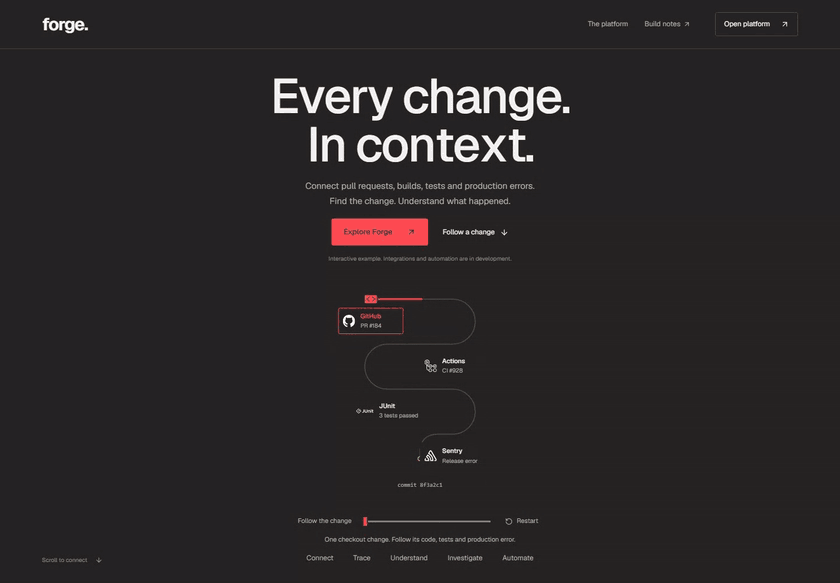
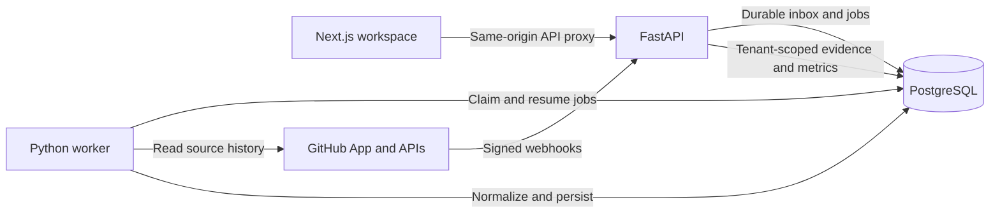

# Forge

**Follow a code change. Understand the evidence behind its delivery.**

Forge brings GitHub pull requests, commits, CI attempts and deployment history into one engineering workspace. Start with a metric, open the records behind it, and inspect the reviews, jobs or deployment statuses that explain it. Missing evidence stays visible through sample counts, exclusions and source coverage.

[](docs/media/forge-landing.gif)

The landing page uses Anime.js to draw a scroll-driven SVG track and animate the accompanying explanations and code previews. Its story includes planned test, production-error and automation capabilities; those examples are illustrative. [About the animation](docs/landing-page.md)

**Current milestone: Phase 5 — CI/CD intelligence.** Accounts, organizations, GitHub ingestion, PR/commit analytics and CI/deployment evidence are implemented. This repository runs locally; production deployment, test intelligence, Sentry and automated responses remain on the roadmap.

[Quick start](#quick-start) · [Explore the demo](#explore-without-connecting-github) · [Connect GitHub](#connect-your-tools) · [Architecture](#how-it-works) · [Roadmap](#whats-next)

## What you can do today

| Surface                           | What it answers                                                                                                                                                           |
| --------------------------------- | ------------------------------------------------------------------------------------------------------------------------------------------------------------------------- |
| Engineering overview              | How long from PR creation to merge, creation to first review, and approval to merge? Inspect mean, median, P75 and P95 with included and excluded samples.                |
| Pull requests and commits         | Which reviews, lifecycle events, changed files and explicit associations support a change's history? Open the imported evidence and available GitHub source links.        |
| CI workflows                      | Which workflow attempts succeed or fail, how long do they take, and which jobs contributed? Retries remain separate attempts with their own outcomes and timing evidence. |
| Deployments                       | Which provider-reported deployments first succeeded, and which environments are production? Inspect status history, commit associations and classification provenance.    |
| Repositories and integrations     | Which repositories are selected, what has been imported, and where is synchronization incomplete? Inspect progress, source windows, retries and permission errors.        |
| Organization and account settings | Manage members, invitations, roles, sessions and linked sign-in providers. Verified owners/admins can set audited environment-classification overrides.                   |

Choose an organization, repository and UTC window, then follow a metric's cohort link into the matching records. Filters and pagination preserve that scope. The **Refresh data** action reloads evidence after background imports finish.

### What the numbers mean

- **PR metrics need PR evidence.** Imported commits alone do not produce review or merge timings. Empty samples show “Not available”; the overview explains exclusions and import coverage.
- **A retry is another CI attempt.** Non-decisive conclusions stay separate from success/failure rates. When exact run completion is unavailable, the UI labels the last-job completion proxy; unknown rerun queue times remain unknown.
- **A green workflow is not a deployment.** Deployment metrics use GitHub deployment objects and status histories. A deployment's first success counts once, even if later statuses repeat success.
- **An environment name is not a production flag.** Classification uses a provider flag or an explicit Forge override. Deployment frequency stays unavailable when the requested window lacks complete coverage.

The backend calculates metric distributions from persisted records. The browser formats results and links to evidence; it does not invent missing values. [Metric definitions and limitations](docs/analytics.md)

## Quick start

You need **Git**, **Docker with Compose v2**, and **Node.js 22.x, at least 22.13**, for the configuration helper. Application dependencies and migrations are handled by the containers.

```sh
git clone https://github.com/imranelak1/forge.git
cd forge
node scripts/configure.mjs
docker compose up -d --build --wait --wait-timeout 180
docker compose ps
```

Open **[http://localhost:3000](http://localhost:3000)**. Create an account, verify its email, and create an organization. The default development mail adapter writes messages to `.local/mail/*.eml`; open the verification link inside the matching message. It does not send external email.

The configuration helper creates an ignored `.env` with independent database credentials and an authentication signing key. It refuses to overwrite an existing file. To upgrade an existing installation, run `node scripts/configure.mjs --upgrade`, then rebuild with Compose; existing credentials are preserved.

| Local endpoint                                        | Purpose                                      |
| ----------------------------------------------------- | -------------------------------------------- |
| [localhost:3000](http://localhost:3000)               | Animated landing page                        |
| [localhost:3000/app](http://localhost:3000/app)       | Protected workspace                          |
| [localhost:3000/system](http://localhost:3000/system) | System checks                                |
| [localhost:8000/docs](http://localhost:8000/docs)     | Interactive API documentation in development |

Compose starts **frontend, backend, PostgreSQL and worker**. Host ports default to 3000, 8000 and 15432, bound to loopback. Use `localhost` in the browser to match `FORGE_PUBLIC_ORIGIN`. See the [development guide](docs/development.md) for alternate ports, native workflows, mail settings and troubleshooting.

## Explore without connecting GitHub

Load the optional generated history after the stack is running:

```sh
docker compose exec -T backend python -m forge.seed
```

The command creates two isolated demonstration organizations and prints their generated sign-in credentials **only on first creation**. Sign in with a printed account to explore the workspace.

Demo One contains two repositories, 90 PRs, related reviews/commits/files, **108 workflow attempts and 36 deployments**. Retry attempts, incomplete evidence and repeated successful statuses exercise the same database queries used for live history. Demo Two supplies a separate organization with its own sign-in account.

Demo records are visibly labeled, have no fabricated GitHub source links and cannot trigger live synchronization. Repeating the seed preserves existing credentials, records and environment overrides. It does not seed customer organizations and is disabled in production. [Demo details](docs/development.md#synthetic-demo-identities)

## Connect your tools

Sign-in and repository access are separate integrations:

| Integration              | Setup                                                                                                                                                                                                                               |
| ------------------------ | ----------------------------------------------------------------------------------------------------------------------------------------------------------------------------------------------------------------------------------- |
| GitHub or Google sign-in | Register the OAuth applications and configure their client IDs/secrets. Optional providers stay unavailable until configured. [Social sign-in guide](docs/social-login.md)                                                          |
| GitHub repository access | Register and install a **GitHub App**, authorize it from Forge, bind its installation to an organization and select repositories. Signing in with GitHub does not grant repository access. [GitHub App guide](docs/github-setup.md) |

For repository imports, the App needs Metadata, Contents and Pull requests read access. Organization installations also require Members read access to verify ownership. Issues read access enables optional issue evidence; **Actions read** and **Deployments read** enable their respective histories. Existing installations must accept newly requested permissions.

Configure the documented webhook subscriptions and a reachable HTTPS webhook endpoint for new events. Backfill can run without a public webhook URL; localhost alone cannot receive GitHub deliveries. Missing permissions remain visible, and one unavailable capability does not stop supported PR/commit imports.

Keep provider credentials in `.env` or an appropriate secret store. Provider tokens and private keys stay on the server. The setup guides contain the exact callback URLs, scopes and local configuration steps.

## How it works



PostgreSQL holds identity, tenant membership, source records, durable jobs and audit events. The worker uses resumable checkpoints, leases and idempotent updates to process imports outside the request path. Metrics query the stored evidence with explicit date windows and source watermarks.

Organization authorization is enforced by the API and PostgreSQL row-level security. The application uses a restricted database role; schema migrations use a separate role. Provider access changes fence affected ingestion work while retained history stays inspectable.

There is no running message broker or orchestration cluster. Airflow/dbt, Kafka and ClickHouse are later milestones with documented adoption gates. [Architecture](docs/architecture.md) · [Data model](docs/data-model.md) · [Pipeline design](docs/pipelines.md)

### Stack and repository

| Layer                     | Implementation                                                                                          |
| ------------------------- | ------------------------------------------------------------------------------------------------------- |
| Web                       | Next.js, React, TypeScript, Tailwind CSS, shadcn/ui, TanStack Query; Anime.js for the landing page      |
| API and worker            | Python 3.13, FastAPI, Pydantic, SQLAlchemy, Alembic                                                     |
| Storage and local runtime | PostgreSQL, Docker Compose                                                                              |
| Verification              | pytest with isolated PostgreSQL, Vitest, Testing Library, Playwright, ESLint, TypeScript, Ruff and mypy |

```text
apps/web/          Application, landing page, API proxy and browser tests
apps/api/          API, worker, integrations, migrations and backend tests
infrastructure/    Containers and database-role bootstrap
scripts/           Configuration and isolated backend test runner
docs/              Setup, contracts, architecture, decisions and handoffs
data/              Boundaries for future analytical models and pipelines
```

## Development and verification

With the local stack running:

```sh
npm ci
npm run lint
npm run typecheck
npm test
npm run test:config
npm run format:check
node scripts/test-backend.mjs
```

The backend runner creates and removes an isolated temporary PostgreSQL database; it does not clear the application database. Native backend tooling uses Python 3.13 and uv. The [development guide](docs/development.md#automated-checks) includes installation, production builds and browser-test commands for the Compose stack.

The [Phase 5 handoff](docs/phase-5-review.md) records the completed validation: 312 backend tests, 159 frontend unit tests, 68 desktop/mobile browser checks, and 22 affected browser checks repeated after the final layout correction. These are recorded results for that milestone, not a claim that external provider credentials or every deployment are configured.

For changes, start with the relevant [API contract](docs/apis.md), [metric definition](docs/analytics.md) and [architecture decision](docs/adr/README.md). Preserve tenant boundaries and distinguish absent evidence from a measured zero. The [frontend design reference](apps/web/DESIGN.md) documents the existing workspace and landing behavior.

## What's next

Phases 0–5 establish architecture, the application foundation, identity and organizations, GitHub ingestion, PR analytics and CI/deployment intelligence. The next planned milestones are:

- **Test intelligence:** JUnit ingestion, test histories and evidence for potential flakiness.
- **Production errors:** Sentry integration with release and environment mappings.
- **Lifecycle correlation and automation:** explicit associations, labeled candidates, evidence-based rules and auditable action delivery.
- **Operations and scale:** scheduled reconciliation, analytical models and production deployment; additional infrastructure only when justified.

A separate [product-expansion plan](docs/product-expansion.md) explores public open-source health pages, contribution guidance, individually owned private or shareable profiles, free monitoring for one or two projects, opt-in anonymized benchmarks, and free maintainer tools for public repositories. These are planned directions, not currently available features or launched pricing tiers.

See the [milestone roadmap](docs/roadmap.md) for scope and acceptance gates, the [integration reference](docs/integrations.md) for supported and planned sources, and [security and operations](docs/security-operations.md) for the production requirements still ahead.
