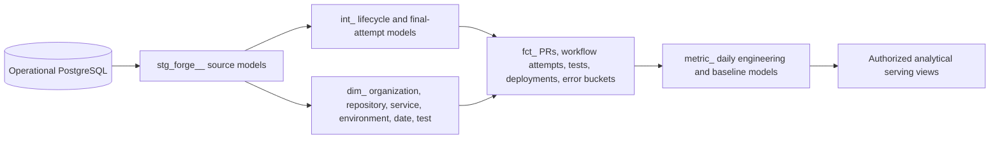

# Metric definitions and analytical model

Status: Phase 4 implements `pr-flow-v1` PR cycle, review-wait and approval-to-merge distributions, daily UTC trends and a separate current open queue using persisted PostgreSQL records. Phase 5 adds `ci-attempts-v1` and `deployments-v1`. Exact percentiles and evidence drill-down share the same eligibility predicates. Test, error and dbt contracts below remain planned.

## Implemented CI and deployment semantics

CI uses one record per provider run **attempt**, including each retry. The completion cohort is `[from,to)` in UTC; decisive conclusions are `success`, `failure`, `timed_out`, `startup_failure` and `action_required`. Both outcome fractions use the same decisive denominator. Other conclusions remain visible separately. Duration and queue distributions use independent timestamp eligibility within that decisive cohort. All aggregates, exact percentiles and evidence predicates are computed in PostgreSQL.

GitHub's workflow REST response has no completion timestamp. Forge derives a **last-job-completion proxy** only after complete terminal job enumeration; `completion_source=jobs` discloses this. Missing or incomplete completion evidence remains unknown and outside the timed cohort. Coverage reports terminal attempts without completion whose `updated_at` falls in the requested activity window, with the same repository/workflow/branch filters. A rerun's original `created_at` is not its queue entry: queue time for later attempts stays unknown. Generic failures retain an unknown cause; no logs or root-cause inference are used. [ADR 013](adr/013-actions-deployment-intelligence.md)

Deployment counts use the first success across **all** retained statuses, once per deployment. Complete status history is required for eligibility. Repeated success and a later inactive state never add or erase that first success. Incomplete observed successes remain visible with exclusions. Production is the default filter, determined by an explicit repository/environment override or provider `production_environment` boolean; missing classification stays unknown and names never classify. CI success does not create deployment facts.

Frequency divides eligible successes on fully covered UTC days by those days only when the entire requested window is covered. Raw counts retain the requested half-open bounds, including partial days. Unknown coverage makes frequency unavailable, not zero. Read snapshots are repeatable and readonly; persisted facts, coverage and source watermarks remain inspectable after disconnection.

## Common rules

All queries require a verified tenant and include organization predicates even with RLS enabled. Repository, service, environment and time filters apply consistently to numerator, denominator, baseline and evidence. Aggregate each fact to its required grain before joining many-to-many links to avoid fan-out. Do not average repository rates to obtain an organization rate: recompute from summed eligible counts.

Use `[from, to)` UTC windows. Daily display can use the organization's timezone with explicit DST handling, while exact instants remain UTC. Return sample counts, exclusions, observed source coverage, formula version and input watermark. Incomplete source coverage cannot produce a healthy status. Percentiles are exact PostgreSQL `percentile_cont` initially; choose approximation only in a separately versioned metric.

## Metric catalog

| Metric                      | Definition and query grain                                                                                                         | Exclusions / evidence                                                                                                                                              |
| --------------------------- | ---------------------------------------------------------------------------------------------------------------------------------- | ------------------------------------------------------------------------------------------------------------------------------------------------------------------ |
| Deployments                 | Count distinct deployment IDs with their **first successful** completion in the window, production environments by default         | Repeated success statuses count once; canceled/failed/in-progress shown separately; no inferred deploy from workflow success                                       |
| Deployment frequency        | Successful deployments divided by fully covered days in the window; also return the raw daily series                               | Partial days/unknown coverage disclosed; zero only with complete source coverage                                                                                   |
| PR cycle time               | `merged_at - opened_at` for PRs merged in the window; return mean, median, P75, P95                                                | Exclude unmerged/invalid negative durations; draft time included initially and documented                                                                          |
| PR review waiting           | `first_substantive_review_at - opened_at` for the same merged PR cohort                                                            | First submitted non-pending, non-bot review by someone other than author; include commented/approved/changes-requested; exclude missing review with coverage count |
| PR time to merge            | `merged_at - first_approved_at` for the same merged cohort                                                                         | This label specifically means **approval-to-merge**, avoiding duplication of cycle time; missing approval excluded; historical dismissed approvals flagged         |
| Open PR age                 | `as_of - opened_at` for PRs open at query time                                                                                     | Separate live queue metric, never inserted into merged cycle-time distribution                                                                                     |
| CI success rate             | Successful attempts / decisive completed attempts in window, per attempt completion time                                           | Decisive conclusions: success, failure, timed_out, startup_failure, action_required; canceled/skipped/neutral/stale/unknown separate                               |
| CI failure rate             | Failed decisive attempts / all decisive attempts, with the same denominator                                                        | Failed set is all decisive non-success conclusions; raw provider value retained                                                                                    |
| CI duration                 | `completed_at - started_at` for completed attempts with valid times; mean and P95                                                  | Queue time (`started - created`) separate; canceled durations may be shown but not silently mixed into decisive-duration summary                                   |
| Recurring workflow failures | Failed attempt count/rate by provider workflow identity and normalized job failure category over daily buckets                     | Expose sample size; unknown failure category remains unknown; no assertion of root cause from message similarity                                                   |
| Test pass rate              | Passed eligible test executions / (passed + failed + error), for selected report runs                                              | Skipped excluded and reported; prefer final retry per identity/parameter/shard within an attempt; report completeness accompanies rate                             |
| Potential flaky tests       | Logical tests with enough completed executions, a failure rate within configured bounds, and enough pass/fail transitions          | Default: 14 days, 10 executions, failure fraction 0.05–0.95, at least two flips; partition by repository/test/branch/environment; not proof of a flaky defect      |
| Production errors           | Sum authoritative error occurrence buckets over disjoint scopes within window                                                      | Never sum lifetime group snapshots or sampled event rows as a full count                                                                                           |
| Error occurrence rate       | Occurrences / fully observed minutes for the same scope/window                                                                     | Display `errors/min`, not `%`; missing request denominator means request-normalized rate unavailable                                                               |
| Affected users              | Provider distinct-user result for exact requested interval/scope, or exact distinct pseudonymous IDs if complete event data exists | Never sum group/bucket distincts; sampled data labeled or unavailable                                                                                              |
| Error groups                | Distinct source group IDs with observed activity within window                                                                     | Group count differs from event occurrence count                                                                                                                    |
| Alerts                      | Open/acknowledged incident count as of query; optionally newly created incidents in window                                         | Snapshot versus flow are separate metric keys                                                                                                                      |
| Automated actions           | Counts by requested, pending, accepted, confirmed, failed and unknown execution state                                              | Retries do not count as additional actions; webhook acceptance does not mean pipeline halted                                                                       |

For test overview, select the latest completed workflow attempt for each provider run and non-superseded reports. Drill-down preserves earlier failed attempts/retries so CI recovery and flaky behavior remain visible. Flakiness history can use retry observations, but its method must state whether it counts final outcomes or intra-attempt reversals. Initial method uses one final outcome per workflow attempt and records same-SHA retry reversals as separate supporting evidence. Test identities lacking branch/environment separation are labeled reduced confidence.

For PRs with reopened intervals, initial cycle time remains wall-clock time from first opening to final merge; transitions support later active-time metrics without silently changing this definition. First approval is historical; display whether it was subsequently dismissed and do not treat it as current merge authorization.

## Operational SQL designs

The PR example illustrates the implemented formula; executable queries and common evidence predicates live in `apps/api/src/forge/repositories/analytics.py`. The other query specifications remain planned. Names correspond to [the logical model](data-model.md). Bind parameters through SQLAlchemy; never interpolate IDs or SQL fragments.

Merged PR cycle-time summary:

```sql
WITH cohort AS (
    SELECT id, EXTRACT(EPOCH FROM (merged_at - opened_at)) AS seconds
    FROM pull_requests
    WHERE organization_id = :organization_id
      AND repository_id = :repository_id
      AND merged_at >= :from_time AND merged_at < :to_time
      AND opened_at IS NOT NULL AND merged_at >= opened_at
)
SELECT COUNT(*) AS sample_count,
       AVG(seconds) AS average_seconds,
       percentile_cont(0.50) WITHIN GROUP (ORDER BY seconds) AS median_seconds,
       percentile_cont(0.75) WITHIN GROUP (ORDER BY seconds) AS p75_seconds,
       percentile_cont(0.95) WITHIN GROUP (ORDER BY seconds) AS p95_seconds
FROM cohort;
```

Review-waiting and approval-to-merge use the same cohort/window but their own timestamp-validity predicate and returned exclusion count. Evidence queries share the exact cohort builder and return contributing PR IDs and durations.

CI decisive-attempt metrics:

```sql
WITH attempts AS (
    SELECT id, conclusion,
           EXTRACT(EPOCH FROM (completed_at - started_at)) AS duration_seconds
    FROM workflow_runs
    WHERE organization_id = :organization_id
      AND repository_id = :repository_id
      AND completed_at >= :from_time AND completed_at < :to_time
      AND conclusion IN ('success', 'failure', 'timed_out',
                         'startup_failure', 'action_required')
)
SELECT COUNT(*) AS decisive_attempts,
       COUNT(*) FILTER (WHERE conclusion = 'success') AS successes,
       COUNT(*) FILTER (WHERE conclusion <> 'success') AS failures,
       COUNT(*) FILTER (WHERE conclusion = 'success')::numeric
           / NULLIF(COUNT(*), 0) AS success_fraction,
       AVG(duration_seconds) FILTER (WHERE duration_seconds >= 0) AS mean_seconds,
       percentile_cont(0.95) WITHIN GROUP (ORDER BY duration_seconds)
           FILTER (WHERE duration_seconds >= 0) AS p95_seconds
FROM attempts;
```

Duration coverage is returned separately from attempt count. Additional grouped queries return excluded conclusions and trends; a CI success fraction without those counts is insufficient evidence.

Production error queries first select a single nonoverlapping scope/granularity and complete buckets in the requested interval. Sum counts, divide by observed duration, and return missing bucket count; requests must align to the selected grain or explicitly report the effective window. Baseline queries use the same scope and metric definition on an earlier disjoint interval. Partial buckets are not prorated as if uniform activity were known.

Flakiness queries select eligible final outcomes, use `LAG(outcome)` partitioned by test identity/branch/environment and ordered by source run time plus deterministic ID, then count transitions alongside pass/fail samples. Skips do not become failures. The result returns the actual outcome sequence for inspection.

Repository listing is also database-backed: stored language/default branch, `MAX` known activity timestamps, current open PR count, latest default-branch CI attempt, production error anomaly/coverage state and count of enabled rules applicable to that repository. An unconnected Sentry source yields `unknown`, never `healthy`.

## dbt model architecture (Phase 10)

Operational analytics stays in the backend query layer through Phase 9. Phase 10 introduces dbt for repeatable scheduled historical transformations. Stage normalized operational data rather than making dbt another provider parser. Use thin source staging and explicit business-grain facts. This separation follows dbt's documented staging/intermediate/mart pattern. [dbt modular modeling](https://www.getdbt.com/blog/modular-data-modeling-techniques)



| Layer           | Proposed models and grains                                                                                                                                                                                    |
| --------------- | ------------------------------------------------------------------------------------------------------------------------------------------------------------------------------------------------------------- |
| Sources/staging | `stg_forge__pull_requests`, reviews, commits, workflow runs/jobs, tests, deployments/statuses, error buckets, evaluations; one row per source key with typed status/times                                     |
| Dimensions      | `dim_organization`, `dim_repository`, `dim_service`, `dim_environment`, `dim_test`, `dim_date`; organization dimension is restricted to processing/serving context                                            |
| Bridges         | `bridge_pr_commit`, `bridge_workflow_pr`, `bridge_service_repository`, `bridge_release_commit`; preserve tenant composite keys and avoid fact fan-out                                                         |
| Intermediate    | `int_pr_lifecycle`, `int_workflow_final_attempt`, `int_test_final_execution`, `int_deployment_first_success`, `int_error_complete_buckets`                                                                    |
| Facts           | `fct_pull_request` per PR; `fct_workflow_attempt` per attempt; `fct_test_execution` per case; `fct_deployment` per deployment; `fct_error_bucket` per canonical bucket; `fct_automation_execution` per action |
| Metric marts    | `metric_repository_daily`, `metric_ci_daily`, `metric_test_daily`, `metric_error_15m`, `metric_automation_daily`; each includes organization, relevant dimensions, counts and completeness                    |

Daily marts retain numerators/denominators rather than only percentages. Percentiles are computed from fact durations for the requested period; daily P95s cannot be averaged into monthly P95. Unique users remain exact-scope nonadditive queries. Preserve metric-definition versions and upstream lineage/watermarks.

Incremental keys include `organization_id` and the natural fact key. Select changes using Forge ingestion/update time with overlap, not just provider occurrence time. Recompute impacted windows for late changes and represent deletions/tombstones. Full refresh and incremental results must reconcile on fixed fixtures before serving. On logic changes, rebuild impacted history instead of mixing definitions. [dbt incremental model guidance](https://github.com/dbt-labs/docs.getdbt.com/blob/current/website/docs/docs/build/incremental-models.md)

Run transformations one tenant at a time initially, with transaction-local tenant context and controlled derived-table ownership. A dedicated bootstrap/migration role creates serving tables and RLS; a scoped transform role can write only its tenant rows. Normal tenant jobs must not drop/recreate shared tables and lose policies. CI tests policy preservation and denies web/API access to unprotected staging relations. Airflow obtains tenant job identity via the same narrow dispatcher pattern as workers. Cross-tenant administration requires an explicit separate operational role and audit trail, never a public API credential.

Before switching a metric to a dbt serving model, compare against operational SQL on the same dataset/window and verify count, precision, timezone, exclusions and freshness parity. Route through one `AnalyticsRepository` interface. Metric formulas live on the server and in version-controlled analytical models; frontend code remains presentation-only. Drift checks protect the deliberate overlap during migration.

## Data tests and analytical acceptance

dbt supplies not-null, uniqueness, accepted-values and relationship assertions; Forge adds tenant-composite relationship and metric invariants. [dbt data tests](https://docs.getdbt.com/docs/build/data-tests)

- Unique composite fact keys; no null tenant IDs; every tenant FK resolves within the same organization.
- Valid status sets, nonnegative counts/durations, required timestamps and correct interval ordering.
- Success plus failure equals decisive attempt count; test denominator excludes skipped; no duplicate final executions.
- Replayed webhooks, overlapping polls and incremental reruns leave counts unchanged.
- Bucket intervals do not overlap for one canonical scope; partial/unknown periods cannot masquerade as zero.
- Small fixtures with hand-calculated percentiles, outcome flips, baseline thresholds and window boundaries.
- Full refresh versus incremental parity, deletion propagation, and mismatched-tenant failure fixtures.
- Source freshness failures prevent publication of healthy automated decisions; a stale mart retains its last watermark.

Historical trends are useful only when coverage and definition versions are visible. No seed value, client constant or placeholder becomes a production metric.
