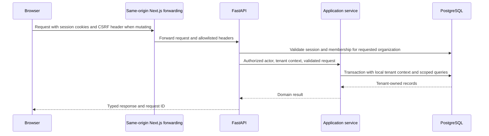

# API architecture

Status: Health, identity/session, organization, social-login and Phase 3 GitHub integration routes are implemented under `/api/v1`. Phase 4 adds PR/commit/issue records, paginated evidence and PR timing metrics. Phase 5 adds CI/deployment metrics, workflow/job and deployment/status evidence, and audited environment classification. Phase 6 adds scoped JUnit uploads, token/policy management and test evidence/analytics. Error analytics and automation remain planned. Development OpenAPI at `/api/v1/openapi.json` is the executable schema; interactive documentation is at `/docs`.

## Implemented test intelligence routes

Routes below follow `/api/v1/organizations/{organization}`. Read access requires active tenant membership. Human mutations require a verified owner/admin and CSRF; upload is a separate machine-only operation. Unknown or inaccessible resources return 404. Read lists use signed, filter-bound pagination, default 30 and maximum 100 rows.

| Method     | Route                               | Purpose                                                                                                              |
| ---------- | ----------------------------------- | -------------------------------------------------------------------------------------------------------------------- |
| GET, POST  | `/repositories/{id}/service-tokens` | List credentials or create a repository-scoped, expiring upload token; raw credential returned only on creation      |
| DELETE     | `/service-tokens/{id}`              | Revoke the token and pending ingestion                                                                               |
| GET, PATCH | `/repositories/{id}/test-policy`    | Read or audit/version potential-flakiness thresholds and excluded branches                                           |
| POST       | `/repositories/{id}/test-reports`   | Machine bearer token, raw uncompressed XML; 202 receipt, asynchronous parsing                                        |
| GET        | `/metrics/tests`                    | Final-outcome pass rate, UTC daily trend, sample counts and upload/timestamp coverage                                |
| GET        | `/test-runs`                        | Report receipts, including pending/failed/superseded evidence                                                        |
| GET        | `/test-runs/{id}`                   | Report details, warnings, timing provenance and child counts                                                         |
| GET        | `/test-runs/{id}/{suites,cases}`    | Paginated nested-suite metadata and executions, including explicit retries and bounded messages                      |
| GET        | `/tests`                            | Potential-flakiness candidates and policy evidence; `potential_only=false` includes non-flagged comparable histories |
| GET        | `/tests/{id}/history`               | Scoped identity history with preserved report and retry evidence                                                     |

Upload query fields are `workflow_run_id` (numeric GitHub provider ID), `run_attempt`, `report_key`, optional `shard` (default `default`), `framework` (default `junit`), `environment`, full lowercase `commit_sha` and correction `supersedes` (receipt UUID). The exact attempt must already exist in the same repository; otherwise `workflow_not_imported` returns 422. Branch/SHA are copied from that parent. A supplied mismatched SHA returns 409. Machine credentials cannot read report content and browser session cookies do not authorize upload. The browser proxy deliberately rejects XML; use the backend API origin. [Upload commands and limits](junit-setup.md)

Receipts expose `queued`, `processing`, `completed` or `failed`, fixed errors, timestamps and supersession references. Cancellation is `failed` with an explicit reason. An identical report identity/digest reuses its receipt; changed content requires the current `supersedes` ID. Old metrics remain until the correction completes. Failed corrections and pending uploads do not become zero-test successes.

Metrics/report lists accept repository UUID, exact branch/environment and UTC `[from,to)` bounds. Potential-flakiness queries use each repository's policy lookback ending at `to`; report details remain available outside eligible metric cohorts. Case lists may filter `passed|failed|error|skipped`. Source completion provenance, unknown timing, missing reports and unknown expected-shard inventory remain explicit.

Policy fields are `window_days` (2–90), `min_executions` (2–1000), `failure_rate_low/high` (`0 < low < high < 1`), `min_transitions` (1–100) and up to 50 exact `excluded_branches`. Defaults are 14 days, 10 observations, 0.05–0.95 failure fraction and two transitions. API policy management uses these storage names; candidate evidence labels them `lookback_days`, `failure_rate_min/max` and `min_flips`, alongside the version. Test evidence is tenant data, including source-authored failure messages; no endpoint returns raw XML, stdout/stderr or token hashes.

## Implemented CI/CD routes

All routes below follow `/api/v1/organizations/{organization}`. Reads require active tenant membership; inaccessible resources return 404. Windows are aware UTC `[from,to)`, default 90 days and maximum 366. Lists return `{items,next_cursor,window,coverage}`; child lists return `{items,next_cursor}`. Signed cursors bind the tenant, resource, filters, page size and window. Limits default to 30, maximum 100.

| Method | Route                                              | Purpose                                                                                       |
| ------ | -------------------------------------------------- | --------------------------------------------------------------------------------------------- |
| GET    | `/metrics/ci`                                      | Attempt outcomes, timing distributions, daily trend, recurring workflow failures and coverage |
| GET    | `/workflow-runs`                                   | Attempt history, completed cohort and eligible/excluded metric evidence                       |
| GET    | `/workflow-runs/{id}`                              | Attempt detail and child counts                                                               |
| GET    | `/workflow-runs/{id}/{jobs,pull-requests,commits}` | Paged job metadata and explicit source links                                                  |
| GET    | `/metrics/deployments`                             | First-success counts, frequency, exclusions and daily trend                                   |
| GET    | `/deployments`                                     | Created or first-success cohort with eligibility filters                                      |
| GET    | `/deployments/{id}`                                | Deployment detail, classification provenance and coverage                                     |
| GET    | `/deployments/{id}/{statuses,commits}`             | Paged source states and same-repository SHA links                                             |
| GET    | `/repositories/{id}/environments`                  | Retained environments, override and classification counts                                     |
| PUT    | `/repositories/{id}/environments/classification`   | Verified owner/admin override with CSRF, origin check and tenant audit                        |

CI filters: repository UUID, provider workflow ID and exact branch. Attempt lists additionally accept `cohort=activity|completed`, `outcome=all|success|failure|other`, `metric=duration|queue` and `eligibility=all|eligible|excluded`. Activity uses original run creation; completed and metric evidence match the analytics completion cohort. Completion provenance and unknown terminal completion counts are explicit.

Deployment filters: repository UUID, exact environment and `classification=production|nonproduction|unknown|all` (default production). Lists accept `cohort=created|success` and eligibility. Classification mutation body is `{environment,classification}`, where classification is `production`, `nonproduction` or null to remove the override. The environment must already exist; the change updates Forge analytics only. Metric formulas and coverage rules are in [Analytics](analytics.md).

## Request path

The browser and API use one public origin. Next.js forwards transport only; FastAPI owns auth and business rules. Do not implement a second authentication authority in Next.js. Internal API addresses and provider tokens never enter public environment variables.

## Authentication and authorization contract

Email/password sessions use Argon2id, short-lived signed access tokens (initial target 10 minutes) and random opaque refresh tokens (initial target 30 days maximum). Both are HttpOnly cookies in production; refresh tokens rotate on every successful use and are stored only as hashes with their token family. Require an active session and current membership on every protected request so revocations take effect immediately. Validate JWT issuer, audience, expiry, signature and an explicit algorithm allowlist. Roles in tokens are not authoritative.

State-changing cookie requests require a session-bound CSRF token and validated origin; SameSite is additional protection. Cookies are Secure in production, host-only, and scoped appropriately; logout clears both. Do not expose tokens to localStorage. Development HTTP exceptions must be explicit and rejected by production config validation.

All organization endpoints have `/organizations/{organization_id}`. The path selects a tenant; the server verifies membership before setting database tenant context. Resource IDs, request body tenant IDs, cursor IDs, and cache keys are untrusted. Omit organization IDs from writable body schemas; derive them from the verified context. Cross-tenant resource access returns a generic 404. An authenticated member lacking a permitted operation receives 403.

| Operation                                                    | Viewer | Member | Admin | Owner |
| ------------------------------------------------------------ | ------ | ------ | ----- | ----- |
| Read engineering data, metrics, alerts and rule history      | Yes    | Yes    | Yes   | Yes   |
| Acknowledge/resolve alerts                                   | No     | Yes    | Yes   | Yes   |
| Manage projects (planned)                                    | No     | Yes    | Yes   | Yes   |
| Connect integrations, map sources, create upload credentials | No     | No     | Yes   | Yes   |
| Configure/enable rules and outbound destinations             | No     | No     | Yes   | Yes   |
| Invite/manage non-owner members                              | No     | No     | Yes   | Yes   |
| Grant/remove owner, delete organization                      | No     | No     | No    | Yes   |

Phase 3 integration mutations and manual sync require a verified owner/admin; viewers and members can read connection and selected repository data. Project grouping and the broader engineering permissions above remain planned.

Last-owner changes run under a membership/organization lock. Service tokens accept only named machine scopes, initially `test_reports:write` for one repository; they do not inherit human admin rights. Signed webhooks resolve tenancy from server-controlled integration bindings, not browser sessions.

## Endpoint inventory

Phase 4 read routes also page child evidence: `/pull-requests/{id}/{reviews,transitions,commits,issues}`, `/commits/{id}/{files,pull-requests}`, and `/issues/{id}/pull-requests`, all beneath the organization prefix. `/issues/{id}` returns issue detail. Lists return `{items,next_cursor,window?}`; child collections have their own bounded cursor. List limits are 1–100 (default 30). Cursors are signed and bound to organization, route, resource, filters, ordering and page size; default time windows are preserved across pages.

PR/commit metrics and lists accept optional `repository`, exact case-insensitive `author`, and timezone-aware `from`/`to` bounds (half-open UTC, default 90 days, at most 366). Without a repository ID, reads include selected repositories and their retained history. PR lists additionally accept `state=all|open|closed|merged`, `cohort=activity|merged`, `metric=cycle_time|review_wait|approval_to_merge` and `eligibility=eligible|excluded|all`. A metric selects the merged cohort and defaults to eligible evidence. Repository issue lists use last activity with their own state filter.

Metrics return `formula_version`, `as_of`, `window`, `scope`, `merged_count`, three distributions, daily `trend`, a separate `open_queue`, and `coverage`. Distributions include exact mean/median/P75/P95 seconds, eligible/excluded counts and exclusion reasons. Unknown durations and unsafe/absent source URLs are null. Evidence coverage remains one of pending/partial/complete/failed/unavailable. Analytics reads never contact GitHub and never infer approval from an unknown dismissed review.

`{org}` below abbreviates `/organizations/{organization_id}`. Every listed resource route is tenant scoped. Implement only the endpoints required by the active milestone.

| Phase | Method and route after `/api/v1`                                                                     | Behavior                                                                                    |
| ----- | ---------------------------------------------------------------------------------------------------- | ------------------------------------------------------------------------------------------- |
| 1     | `GET /health/live`, `GET /health/ready`                                                              | Process liveness and DB/migration readiness; no internal details exposed                    |
| 2     | `POST /auth/register`, `POST /auth/login`                                                            | Create identity / set cookies; organization creation is separate                            |
| 2     | `POST /auth/refresh`, `POST /auth/logout`                                                            | Rotate/revoke session; CSRF and origin protected                                            |
| 2     | `GET /auth/me`, `GET /auth/csrf`                                                                     | Current user/membership summary and bound CSRF token                                        |
| 2     | `POST /auth/verify-email/request`, `POST /auth/verify-email/confirm`                                 | Single-use verification; nonenumerating request response                                    |
| 2     | `POST /auth/password-reset/request`, `POST /auth/password-reset/confirm`                             | Expiring one-use reset; revoke sessions on completion                                       |
| 2     | `GET, POST /organizations`; `GET, PATCH, DELETE {org}`                                               | Membership-visible listing; create/update; owner-only immediate soft deactivation           |
| 2     | `GET /auth/sessions`; `DELETE /auth/sessions/{session_id}`                                           | List active sessions and revoke one immediately                                             |
| 2     | `GET {org}/audit`                                                                                    | Read the organization's append-only audit history                                           |
| 2     | `GET {org}/members`; `PATCH, DELETE {org}/members/{member_id}`                                       | Role/member management                                                                      |
| 2     | `POST {org}/invitations`; `POST /invitations/accept`                                                 | Verified matching email and single-use token required for acceptance                        |
| 2+    | `GET /auth/providers`, `GET /auth/connections`                                                       | Public provider availability / authenticated connected identities                           |
| 2+    | `POST /auth/oauth/{provider}/start`, `GET /auth/oauth/{provider}/callback`                           | GitHub/Google login or explicit linking; CSRF-protected start, one-use bound callback state |
| 3     | `GET {org}/integrations/github`                                                                      | App availability, pending authorization and connection status                               |
| 3     | `POST {org}/integrations/github/authorize`; `GET /integrations/github/callback`                      | Session-bound GitHub App authorization and fixed UI redirect                                |
| 3     | `GET {org}/integrations/github/authorizations/{id}/installations`                                    | Fresh installation choices for the authorizing GitHub user                                  |
| 3     | `POST {org}/integrations/github/connections`                                                         | Verify source administrator, bind installation, enqueue catalog                             |
| 3     | `POST {org}/integrations/github/connections/{id}/refresh`; `DELETE .../connections/{id}`             | Recheck access and refresh catalog; disconnect and cancel work                              |
| 3     | `GET {org}/integrations/github/connections/{id}/repositories`; `POST .../connections/{id}/selection` | Cursor-paged catalog and explicit repository selection                                      |
| 3     | `GET {org}/repositories`                                                                             | Selected repository metadata, stored counts and latest sync                                 |
| 3     | `POST {org}/repositories/{id}/sync`; `GET {org}/repositories/{id}/sync-runs`                         | Durable sync request and cursor-paged history                                               |
| 3     | `POST /webhooks/github`                                                                              | Raw-body signature verification and atomic receipt/job acceptance                           |
| 4     | `GET {org}/repositories/{id}/issues`, `{org}/pull-requests`, `{org}/commits`                         | Paginated engineering records                                                               |
| 4     | `GET {org}/pull-requests/{id}`; `GET {org}/commits/{id}`                                             | Reviews, transitions, file metadata and known associations                                  |
| 4     | `GET {org}/metrics/pull-requests`                                                                    | Average, median, P75, P95 and coverage for timing metrics                                   |
| 5     | `GET {org}/workflow-runs`; `GET {org}/workflow-runs/{id}`                                            | Attempts, jobs and failure evidence                                                         |
| 5     | `GET {org}/deployments`; `GET {org}/deployments/{id}`                                                | Deployment history and statuses                                                             |
| 5     | `GET {org}/metrics/ci`, `GET {org}/metrics/deployments`                                              | Defined aggregate/time-series metrics                                                       |
| 6     | `POST {org}/repositories/{id}/test-reports`                                                          | Bounded JUnit XML upload, 202 with ingestion/job references                                 |
| 6     | `GET {org}/test-runs`; `GET {org}/test-runs/{id}`; `GET {org}/tests/{id}/history`                    | Suites, executions and identity history                                                     |
| 6     | `GET {org}/metrics/tests`; `GET, PATCH {org}/repositories/{id}/test-policy`                          | Pass rate and configurable potential-flakiness evidence                                     |
| 6     | `POST {org}/repositories/{id}/service-tokens`; `DELETE {org}/service-tokens/{id}`                    | Reveal upload credential once / revoke                                                      |
| 7     | `GET {org}/errors`; `GET {org}/errors/{id}`; `GET {org}/metrics/errors`                              | Sentry groups, samples, scoped bucket trends and coverage                                   |
| 7     | `GET, POST {org}/services`; `PATCH {org}/services/{id}`; `GET, POST {org}/environments`              | Configure deployment/error scope                                                            |
| 7     | `PUT {org}/integrations/{id}/mappings`                                                               | Validate Sentry project/service/repository/environment mappings                             |
| 8     | `GET {org}/repositories/{id}/lifecycle`; `GET {org}/correlations/{id}`                               | Explicit relationships and separate temporal evidence                                       |
| 9     | `GET, POST {org}/automation-rules`; `GET, PATCH, DELETE {org}/automation-rules/{id}`                 | Versioned configuration; deletion archives rule and preserves history                       |
| 9     | `POST {org}/automation-rules/{id}/preview`                                                           | Historical read-only evaluation with no side effects                                        |
| 9     | `POST {org}/automation-rules/{id}/enable`, `/disable`                                                | Authorized audited state transitions                                                        |
| 9     | `GET, POST {org}/webhook-destinations`; `PATCH, DELETE {org}/webhook-destinations/{id}`              | Validated destinations; cannot delete one referenced by enabled rules                       |
| 9     | `GET {org}/alerts`; `GET {org}/alerts/{id}`; `POST {org}/alerts/{id}/acknowledge`, `/resolve`        | Incident list/detail with evidence and audited status changes                               |
| 9     | `GET {org}/automation-executions`; `GET {org}/automation-executions/{id}`                            | Separate requested/sent/acknowledged/failed/unknown delivery states                         |
| 9     | `GET {org}/metrics/overview`; `GET {org}/metric-evidence/{id}`                                       | Combined implemented metrics and paginated contributor drill-down                           |

The overview can be introduced incrementally in Phases 4–7 with unavailable metric sections explicitly labeled; the full contract is complete in Phase 9. Email verification/reset requires a configured delivery adapter; local development uses a documented local sink, never a success response that pretends mail was delivered.

## Validation, paging and consistency

Phase 2 uses a fixed stable UUID order and signed, actor/organization-bound cursors on organization, member, audit and session lists. Sorting/filter controls below describe later engineering APIs. Organization deactivation returns 204 and immediately denies access; physical purging and integration shutdown workers arrive with the data they need to process. There is no pending invitation list/revoke API yet.

The browser obtains `{csrf_token}` from `GET /auth/csrf` before every mutation, including sign-up/sign-in and identity-token confirmation. Forward the exact browser `Origin` and `X-CSRF-Token`. Register/login/refresh return `{user,session_id}` and set cookies; `/auth/me` adds `organizations`. Verification and reset requests return generic 202 responses. Links carry one-use tokens in URL fragments; the UI captures and strips them before submission. No raw invitation or reset token is returned from a JSON API.

List routes use `limit` (default 50, maximum 100), an opaque signed cursor, allowlisted `sort` and endpoint-specific filters. Stable order always includes internal ID as a tiebreaker. Cursor contents bind organization, filters, sort and boundary; changing any invalidates the cursor. A cursor is never authorization. Lists use keyset pagination and disclose that concurrent writes can change the live view; exact exports use an explicit snapshot job later. No arbitrary field or SQL sort expressions.

Time-series requests accept `from`, `to`, bucket granularity, and applicable repository/service/environment IDs. Reject reversed or excessive windows (initial maximum 180 days); validate that every scope belongs to the tenant. All IDs are UUIDs, enums are explicit, unknown writable fields are rejected, and lengths/body sizes are bounded. Use database uniqueness checks for race-safe conflict handling.

Return `{ "data": [...], "page": { "next_cursor": null, "has_more": false } }` for lists. Metric responses include `metric_key`, `definition_version`, `value`, `unit`, `sample_count`, `coverage`, `window`, `freshness`, `filters`, `evidence_url`, and baseline inputs when relevant. Empty/insufficient input returns `value: null` with a reason, not zero. A zero is valid only with known complete observations and a defined denominator.

`POST` job requests and action-related mutations accept an `Idempotency-Key`, scoped to tenant, actor and operation. Store payload hash and result for an initial 24-hour window; reuse with different content returns 409. Longer-lived workflow dedup keys remain in the domain tables. A 202 response contains a durable job/status URL, never implies completion. Mutable configurations expose a revision and require `If-Match` to avoid silently overwriting edits.

## Error and HTTP contract

Use `application/problem+json` with `type`, `title`, `status`, safe `detail`, `instance`, stable application `code`, and `request_id`; validation errors optionally include a bounded `errors` list of field paths/codes. Do not return stack traces, SQL, token material or another tenant's existence.

| Status          | Meaning                                                                                            |
| --------------- | -------------------------------------------------------------------------------------------------- |
| 400 / 422       | Malformed request / field or domain validation                                                     |
| 401 / 403 / 404 | Missing session or invalid webhook signature / insufficient role / absent or inaccessible resource |
| 409 / 412       | Natural-key or idempotency conflict / stale configuration revision                                 |
| 413 / 415       | Oversized input / unsupported content type                                                         |
| 429             | Rate limited, with safe `Retry-After`                                                              |
| 503             | Required dependency unavailable; retry only when safe                                              |

TanStack Query keys include organization and all metric filters. Clear protected cache on logout or tenant switch. Invalidate affected lists on mutations and poll job status with bounded backoff. The client formats values but does not recalculate rates, percentiles or rule decisions.
