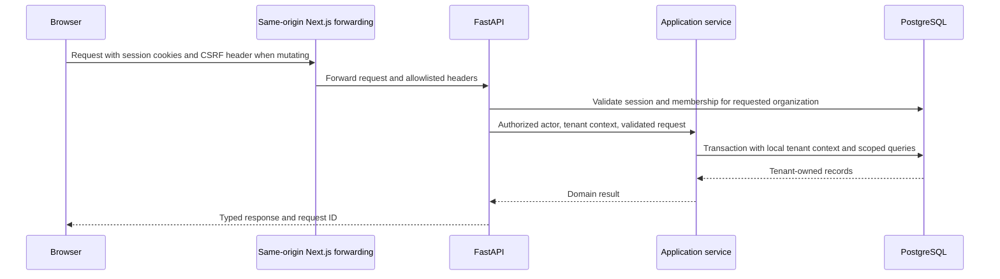

# API architecture

Status: Phase 1 health routes are implemented. All other inventory routes remain planned for their listed phase. Application APIs use `/api/v1`; development OpenAPI is at `/api/v1/openapi.json`, with interactive documentation at `/docs`.

## Request path

The browser and API use one public origin. Next.js forwards transport only; FastAPI owns auth and business rules. Do not implement a second authentication authority in Next.js. Internal API addresses and provider tokens never enter public environment variables.

## Authentication and authorization contract

Email/password sessions use Argon2id, short-lived signed access tokens (initial target 10 minutes) and random opaque refresh tokens (initial target 30 days maximum). Both are HttpOnly cookies in production; refresh tokens rotate on every successful use and are stored only as hashes with their token family. Require an active session and current membership on every protected request so revocations take effect immediately. Validate JWT issuer, audience, expiry, signature and an explicit algorithm allowlist. Roles in tokens are not authoritative.

State-changing cookie requests require a session-bound CSRF token and validated origin; SameSite is additional protection. Cookies are Secure in production, host-only, and scoped appropriately; logout clears both. Do not expose tokens to localStorage. Development HTTP exceptions must be explicit and rejected by production config validation.

All organization endpoints have `/organizations/{organization_id}`. The path selects a tenant; the server verifies membership before setting database tenant context. Resource IDs, request body tenant IDs, cursor IDs, and cache keys are untrusted. Omit organization IDs from writable body schemas; derive them from the verified context. Cross-tenant resource access returns a generic 404. An authenticated member lacking a permitted operation receives 403.

| Operation                                                    | Viewer | Member | Admin | Owner |
| ------------------------------------------------------------ | ------ | ------ | ----- | ----- |
| Read engineering data, metrics, alerts and rule history      | Yes    | Yes    | Yes   | Yes   |
| Acknowledge/resolve alerts                                   | No     | Yes    | Yes   | Yes   |
| Manage projects, request repository sync                     | No     | Yes    | Yes   | Yes   |
| Connect integrations, map sources, create upload credentials | No     | No     | Yes   | Yes   |
| Configure/enable rules and outbound destinations             | No     | No     | Yes   | Yes   |
| Invite/manage non-owner members                              | No     | No     | Yes   | Yes   |
| Grant/remove owner, delete organization                      | No     | No     | No    | Yes   |

Last-owner changes run under a membership/organization lock. Service tokens accept only named machine scopes, initially `test_reports:write` for one repository; they do not inherit human admin rights. Signed webhooks resolve tenancy from server-controlled integration bindings, not browser sessions.

## Endpoint inventory

`{org}` below abbreviates `/organizations/{organization_id}`. Every listed resource route is tenant scoped. Implement only the endpoints required by the active milestone.

| Phase | Method and route after `/api/v1`                                                              | Behavior                                                                                        |
| ----- | --------------------------------------------------------------------------------------------- | ----------------------------------------------------------------------------------------------- |
| 1     | `GET /health/live`, `GET /health/ready`                                                       | Process liveness and DB/migration readiness; no internal details exposed                        |
| 2     | `POST /auth/register`, `POST /auth/login`                                                     | Create identity / set cookies; organization creation is separate                                |
| 2     | `POST /auth/refresh`, `POST /auth/logout`                                                     | Rotate/revoke session; CSRF and origin protected                                                |
| 2     | `GET /auth/me`, `GET /auth/csrf`                                                              | Current user/membership summary and bound CSRF token                                            |
| 2     | `POST /auth/verify-email/request`, `POST /auth/verify-email/confirm`                          | Single-use verification; nonenumerating request response                                        |
| 2     | `POST /auth/password-reset/request`, `POST /auth/password-reset/confirm`                      | Expiring one-use reset; revoke sessions on completion                                           |
| 2     | `GET, POST /organizations`; `GET, PATCH, DELETE {org}`                                        | Membership-visible listing; create/update; owner-only asynchronous deletion                     |
| 2     | `GET {org}/members`; `PATCH, DELETE {org}/members/{member_id}`                                | Role/member management                                                                          |
| 2     | `POST {org}/invitations`; `POST /invitations/accept`                                          | Verified matching email and single-use token required for acceptance                            |
| 3     | `GET /auth/github/start`, `GET /auth/github/callback`                                         | OAuth login or authenticated linking, one-use state                                             |
| 3     | `GET, POST {org}/integrations`; `GET, DELETE {org}/integrations/{id}`                         | Configure/list/disconnect with redacted credentials                                             |
| 3     | `POST {org}/integrations/github/installations/start`; `GET /integrations/github/callback`     | Bind verified installation to authorized organization                                           |
| 3     | `GET {org}/integrations/{id}/available-repositories`; `POST {org}/repositories`               | List provider-authorized choices; connect by verified source identity                           |
| 3     | `GET {org}/repositories`; `GET, PATCH {org}/repositories/{id}`                                | Filtered catalog, settings and freshness                                                        |
| 3     | `GET, POST {org}/projects`; `GET, PATCH, DELETE {org}/projects/{id}`                          | Project grouping, with validated repository membership                                          |
| 3     | `POST {org}/repositories/{id}/sync`; `GET {org}/sync-runs/{id}`                               | 202 with durable sync job and progress; safe repeated requests                                  |
| 3     | `POST /webhooks/github/{app_binding_id}`                                                      | Verify App signature, map signed installation identity to tenant, durably accept or deduplicate |
| 4     | `GET {org}/repositories/{id}/issues`, `/pull-requests`, `/commits`                            | Paginated engineering records                                                                   |
| 4     | `GET {org}/pull-requests/{id}`; `GET {org}/commits/{id}`                                      | Reviews, transitions, file metadata and known associations                                      |
| 4     | `GET {org}/metrics/pull-requests`                                                             | Average, median, P75, P95 and coverage for timing metrics                                       |
| 5     | `GET {org}/workflow-runs`; `GET {org}/workflow-runs/{id}`                                     | Attempts, jobs and failure evidence                                                             |
| 5     | `GET {org}/deployments`; `GET {org}/deployments/{id}`                                         | Deployment history and statuses                                                                 |
| 5     | `GET {org}/metrics/ci`, `GET {org}/metrics/deployments`                                       | Defined aggregate/time-series metrics                                                           |
| 6     | `POST {org}/repositories/{id}/test-reports`                                                   | Bounded JUnit XML upload, 202 with ingestion/job references                                     |
| 6     | `GET {org}/test-runs`; `GET {org}/test-runs/{id}`; `GET {org}/tests/{id}/history`             | Suites, executions and identity history                                                         |
| 6     | `GET {org}/metrics/tests`; `GET, PATCH {org}/repositories/{id}/test-policy`                   | Pass rate and configurable potential-flakiness evidence                                         |
| 6     | `POST {org}/repositories/{id}/service-tokens`; `DELETE {org}/service-tokens/{id}`             | Reveal upload credential once / revoke                                                          |
| 7     | `GET {org}/errors`; `GET {org}/errors/{id}`; `GET {org}/metrics/errors`                       | Sentry groups, samples, scoped bucket trends and coverage                                       |
| 7     | `GET, POST {org}/services`; `PATCH {org}/services/{id}`; `GET, POST {org}/environments`       | Configure deployment/error scope                                                                |
| 7     | `PUT {org}/integrations/{id}/mappings`                                                        | Validate Sentry project/service/repository/environment mappings                                 |
| 8     | `GET {org}/repositories/{id}/lifecycle`; `GET {org}/correlations/{id}`                        | Explicit relationships and separate temporal evidence                                           |
| 9     | `GET, POST {org}/automation-rules`; `GET, PATCH, DELETE {org}/automation-rules/{id}`          | Versioned configuration; deletion archives rule and preserves history                           |
| 9     | `POST {org}/automation-rules/{id}/preview`                                                    | Historical read-only evaluation with no side effects                                            |
| 9     | `POST {org}/automation-rules/{id}/enable`, `/disable`                                         | Authorized audited state transitions                                                            |
| 9     | `GET, POST {org}/webhook-destinations`; `PATCH, DELETE {org}/webhook-destinations/{id}`       | Validated destinations; cannot delete one referenced by enabled rules                           |
| 9     | `GET {org}/alerts`; `GET {org}/alerts/{id}`; `POST {org}/alerts/{id}/acknowledge`, `/resolve` | Incident list/detail with evidence and audited status changes                                   |
| 9     | `GET {org}/automation-executions`; `GET {org}/automation-executions/{id}`                     | Separate requested/sent/acknowledged/failed/unknown delivery states                             |
| 9     | `GET {org}/metrics/overview`; `GET {org}/metric-evidence/{id}`                                | Combined implemented metrics and paginated contributor drill-down                               |

The overview can be introduced incrementally in Phases 4–7 with unavailable metric sections explicitly labeled; the full contract is complete in Phase 9. Email verification/reset requires a configured delivery adapter; local development uses a documented local sink, never a success response that pretends mail was delivered.

## Validation, paging and consistency

List routes use `limit` (default 50, maximum 100), an opaque signed cursor, allowlisted `sort` and endpoint-specific filters. Stable order always includes internal ID as a tiebreaker. Cursor contents bind organization, filters, sort and boundary; changing any invalidates the cursor. A cursor is never authorization. Lists use keyset pagination and disclose that concurrent writes can change the live view; exact exports use an explicit snapshot job later. No arbitrary field or SQL sort expressions.

Time-series requests accept `from`, `to`, bucket granularity, and applicable repository/service/environment IDs. Reject reversed or excessive windows (initial maximum 180 days); validate that every scope belongs to the tenant. All IDs are UUIDs, enums are explicit, unknown writable fields are rejected, and lengths/body sizes are bounded. Use database uniqueness checks for race-safe conflict handling.

Return `{ "data": [...], "page": { "next_cursor": null, "has_more": false } }` for lists. Metric responses include `metric_key`, `definition_version`, `value`, `unit`, `sample_count`, `coverage`, `window`, `freshness`, `filters`, `evidence_url`, and baseline inputs when relevant. Empty/insufficient input returns `value: null` with a reason, not zero. A zero is valid only with known complete observations and a defined denominator.

`POST` job requests and action-related mutations accept an `Idempotency-Key`, scoped to tenant, actor and operation. Store payload hash and result for an initial 24-hour window; reuse with different content returns 409. Longer-lived workflow dedup keys remain in the domain tables. A 202 response contains a durable job/status URL, never implies completion. Mutable configurations expose a revision and require `If-Match` to avoid silently overwriting edits.

## Error and HTTP contract

Use `application/problem+json` with `type`, `title`, `status`, safe `detail`, `instance`, stable application `code`, and `request_id`; validation errors optionally include a bounded `errors` list of field paths/codes. Do not return stack traces, SQL, token material or another tenant's existence.

| Status          | Meaning                                                                                            |
| --------------- | -------------------------------------------------------------------------------------------------- |
| 400 / 422       | Malformed request / field or domain validation                                                     |
| 401 / 403 / 404 | Missing session or invalid webhook signature / insufficient role / absent or inaccessible resource |
| 409 / 412       | Natural-key or idempotency conflict / stale configuration revision                                 |
| 413 / 415       | Oversized input / unsupported content type                                                         |
| 429             | Rate limited, with safe `Retry-After`                                                              |
| 503             | Required dependency unavailable; retry only when safe                                              |

TanStack Query keys include organization and all metric filters. Clear protected cache on logout or tenant switch. Invalidate affected lists on mutations and poll job status with bounded backoff. The client formats values but does not recalculate rates, percentiles or rule decisions.
