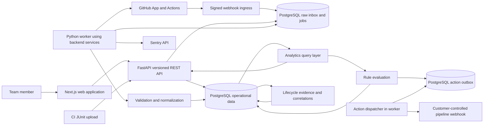
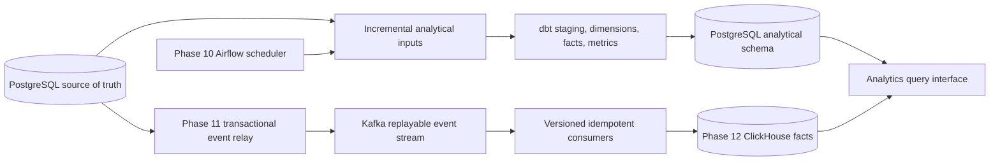

# Forge architecture blueprint

Status: Phase 3 implements verified GitHub App repository connections, signed webhook ingestion and a durable PostgreSQL worker alongside the completed identity/SaaS foundation. See [Phase 3 delivery](phase-3-review.md), [GitHub App setup](github-setup.md), and [ADR 011](adr/011-github-phase-3.md). The diagrams below continue to distinguish the broader phased target.

## Product and system boundaries

Forge answers three connected questions: what changed, what happened afterward, and what response ran? Its primary experience is a repository lifecycle with evidence and actions. An engineering overview is an entry point into those records, not a collection of untraceable dashboard numbers.

A lifecycle can include an issue, PR, changed files and commits, workflow attempts, test executions, a deployment, and production error groups. Missing links stay missing. Explicit provider identifiers establish known links; temporal proximity produces labeled candidate correlations. Forge never claims that proximity proves a deployment caused an error.

The initial supported sources are GitHub, GitHub Actions, JUnit XML, and Sentry. GitLab, Jira/Linear, Jenkins, SonarQube, Playwright/Selenium, and AWS enter through the same integration contracts later. Billing, custom role builders, source-code hosting, and autonomous rollback execution are outside the initial scope.

## System diagram: operational target through Phase 9



Boxes describe logical responsibilities; they are not all independent services. Inbox, jobs, domain records, and outbox share one PostgreSQL database initially. Normalization, correlation, analytics, and automation are modules in the backend codebase. The worker is introduced in Phase 3 and runs as a separate process from the same backend image. The current Compose stack contains frontend, backend, PostgreSQL and the GitHub worker. No broker or scheduler is running.

## Future analytical and streaming extensions



Airflow schedules batch/reconciliation work, not the webhook request path. Kafka is deferred until replay/fan-out throughput warrants it. ClickHouse becomes an analytical projection only; identity, permissions, configuration, and action delivery remain in PostgreSQL. These later phases require an explicit scope decision backed by measurements.

## Backend architecture and dependency rules

| Layer                  | Responsibilities                                                                                             | Allowed dependencies                                                               |
| ---------------------- | ------------------------------------------------------------------------------------------------------------ | ---------------------------------------------------------------------------------- |
| API                    | Parse/validate requests, authenticate, authorize through dependencies, invoke use cases, serialize responses | Pydantic contracts, services, security dependencies                                |
| Services               | Coordinate use cases and transactions; enforce business invariants                                           | Domain, repository interfaces, integration ports, analytics/automation interfaces  |
| Domain                 | Entities, value objects, role policies, transition rules, event contracts                                    | Standard library and small validation primitives; no HTTP clients or route imports |
| Repository/data access | Tenant-scoped SQLAlchemy queries, upserts, unit of work                                                      | Domain interfaces, SQLAlchemy, PostgreSQL                                          |
| Integration            | GitHub/Sentry HTTP clients, pagination, signatures, provider DTO mapping, JUnit parsing                      | Domain contracts, HTTP/XML libraries; persistence through application services     |
| Analytics              | Metric definitions, SQL query implementations, anomaly evidence                                              | Read interfaces/domain types; no UI formatting                                     |
| Automation             | Versioned rule evaluation and action planning                                                                | Metric/evidence ports, domain types; delivery delegated to outbox services         |
| Worker                 | Lease tasks and execute the same application services                                                        | Services and job repository; no duplicated ingestion logic                         |

SQLAlchemy mapping and domain behavior may share a module where practical, but routes must not construct business queries. Use explicit service constructors and a small composition root; do not introduce a generic service framework. Transactions belong to use cases. Provider network calls happen outside database transactions.

## Planned monorepo

This is a proposed layout, not Phase 0 application scaffolding.

```text
apps/
  web/
    src/app/                  # Next.js routes/layouts and same-origin API forwarding
    src/features/             # repositories, lifecycle, intelligence, automation
    src/components/ui/        # shadcn/ui primitives
    src/lib/                  # typed API client and tenant-aware query keys
    tests/                    # component and Playwright tests
  api/
    src/forge/
      api/v1/                 # thin routes and request/response contracts
      services/               # transactional use cases
      domain/                 # entities and invariants
      repositories/           # SQLAlchemy implementations and query builders
      integrations/           # github, junit, sentry
      analytics/              # operational metric queries and evidence
      automation/             # evaluator, action planner, delivery policies
      workers/                # durable job consumer and scheduler entrypoints
      security/               # tokens, password hashing, tenant context, RBAC
      observability/          # structured log and trace context
      config.py
    migrations/               # Alembic is sole operational-schema owner
    tests/                    # unit, PostgreSQL integration, contract tests
data/
  dbt/                        # introduced in Phase 10
  pipelines/                  # scheduled adapters and later Airflow DAGs
infrastructure/               # container/deployment configuration
docs/
  adr/
docker-compose.yml            # Phase 1, three services initially
.github/workflows/            # phase-specific quality/build gates
```

## Frontend product surfaces

Use Next.js, TypeScript, Tailwind CSS, shadcn/ui, TanStack Query, Recharts, and Lucide. Select and lock supported dependency versions in Phase 1. Browser code consumes typed API responses; it never implements metric formulas or receives provider credentials.

| Surface              | User task and data                                                                                                                   |
| -------------------- | ------------------------------------------------------------------------------------------------------------------------------------ |
| Engineering overview | See deployments, PR timing, CI health, tests, errors, alerts and action outcomes; drill into the records contributing to each metric |
| Repositories         | Compare language, default branch, last activity, open PR count, latest CI state, error state, active rules and sync coverage         |
| Repository lifecycle | Follow explicit links and inspect separately labeled temporal candidates; show source links and data freshness                       |
| PR intelligence      | Inspect cycle/review/merge distributions and slow PRs, with timestamp coverage                                                       |
| CI and tests         | Inspect workflow attempts, durations, failure categories, suites, failed cases and potential flakiness                               |
| Production errors    | Filter groups by service/repository/environment/release and inspect deployment evidence                                              |
| Automation           | Configure validated rules, preview evidence, enable actions, inspect evaluations and delivery attempts                               |
| Settings             | Manage organization, membership, integrations and secrets without returning stored credential values                                 |

Dark-first surfaces use dense readable tables, restrained borders, keyboard navigation and responsive detail panels. Green/yellow/red describe state and also have text/icon labels. Charts show a useful time series or distribution and link to source records. Unconnected, syncing, stale, insufficient-data and error states are distinct from zero. Demo organizations have a persistent synthetic-data label. Future features are visibly unavailable until implemented, without simulated success buttons.

## Operational design targets

These are initial test targets, not measured promises: webhook durable acknowledgement p95 below 2 seconds, ordinary list endpoints p95 below 500 ms, and a 90-day single-repository metric query p95 below 2 seconds on documented test hardware. Initial acceptance load: 10 organizations, 100 repositories total, and up to 1 million normalized execution/observation records. Reassess with query plans and load tests before adding infrastructure.

Webhook-derived data should normally be queryable within 60 seconds of receipt; polling-derived data within its configured schedule plus processing time. Report actual source watermarks and queue lag. The system remains usable when a provider is unavailable: stored data stays readable and its age becomes explicit.

See [security and operations](security-operations.md) for deployment, recovery, and tests; [ADRs](adr/README.md) explain the tradeoffs.
