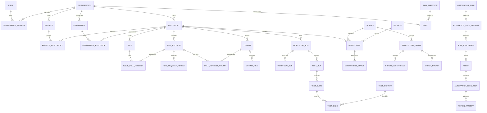

# Entity and tenant model

Status: Phase 2 implements users, sessions, hashed refresh/identity tokens, organizations, memberships, invitations, audit records and persistent authentication rate limits through Alembic `0002_identity`. The requested GitHub/Google login extension adds external identities and OAuth state in `0003_oauth`. The remaining entities below are the phased target model. `0001_foundation` creates the namespace; migrations introduce later domain tables with their feature phases.

## Shared conventions and invariants

- Internal identifiers are UUIDs; provider IDs are separate opaque strings. A GitHub numeric ID, SHA, PR number, or URL is never a tenant authorization credential.
- Every organization-owned row has a non-null `organization_id`. This includes junctions, test cases, background jobs, raw events, metric evidence and action attempts. Global identities and narrowly scoped authentication/routing control records are exceptions documented below.
- Tenant tables expose `UNIQUE (organization_id, id)`. Tenant references use composite foreign keys such as `(organization_id, repository_id) REFERENCES repositories(organization_id, id)`. Validate same-repository relationships as well, using additional composite keys where required.
- Use `timestamptz`, store UTC, serialize RFC 3339, and query half-open windows `[from, to)`. Distinguish provider `occurred_at`/`source_updated_at` from Forge `received_at`/`ingested_at`/`updated_at`.
- Use nonnegative integer counters and numeric durations in seconds. Unknown timestamps and counts are null, never fabricated. JSONB holds bounded provider metadata, rule schemas and evidence, not primary relationship keys.
- Preserve imported source URLs, external IDs, normalization version and lineage. State projections can change; immutable review/status/event observations preserve history.
- Credentials are encrypted with a key outside PostgreSQL; API responses expose credential presence/expiry only. Passwords and opaque tokens are hashed.
- Operational records are deleted through an organization-scoped purge workflow. Restrict accidental parent deletion; explicitly order dependent cleanup. Revoking an integration stops collection but preserves existing history until the owner deletes it.

## Core relationship diagram

Optional commit/workflow/release links are described below rather than drawn as mandatory paths. A deployment can exist without a test report, and a test upload can arrive before its workflow is synchronized.

## Identity and SaaS foundation (Phase 2)

| Entity            | Grain and important fields                                                                                | Constraints                                                                                     |
| ----------------- | --------------------------------------------------------------------------------------------------------- | ----------------------------------------------------------------------------------------------- |
| `users`           | Global person: canonical email, name, nullable Argon2id password hash, email_verified boolean, created_at | Unique canonical email; null hash for provider-only accounts; never expose password hash        |
| `organizations`   | Tenant root: name, slug, created_by, is_demo, created_at, deleted_at                                      | Unique slug; its id is the tenant boundary; soft deactivation denies access                     |
| `memberships`     | One organization/user pair: role owner/admin/member/viewer and created_at                                 | Composite organization/id primary key, unique organization/user, locked last-owner invariant    |
| `invitations`     | Organization, email, role, token_hash, inviter membership, expiry, used_at, revoked_at                    | Composite tenant inviter reference; one-use token; current inviter role rechecked on acceptance |
| `auth_sessions`   | Global user session/family: user_id, csrf_hash, created_at, expires_at, revoked_at                        | Access JWT refers to an active session; per-request revocation check                            |
| `refresh_tokens`  | One opaque refresh token hash: session_id, created_at, used_at                                            | Retain spent hashes for replay detection and family revocation                                  |
| `identity_tokens` | One verification/reset token hash: user_id, purpose, expires_at, used_at, created_at                      | Atomic one-use consumption; reset revokes sessions; no raw token persisted                      |
| `rate_limits`     | Hashed operation/IP or operation/account key: window_start, attempts                                      | Atomic PostgreSQL window counter shared by API processes                                        |
| `audit_events`    | Tenant action: actor_id, subject_id, action, created_at                                                   | Composite organization/id primary key; runtime has SELECT/INSERT only                           |

`0003_oauth` adds `external_identities` keyed by `(provider, subject)`, unique on `(user_id, provider)`, with the observed provider email and creation time. `oauth_states` stores hashed state/browser binding, provider, intent, safe local destination, optional user/session binding, expiry and consumption timestamps. PKCE verifiers and Google nonces are derived with purpose-separated HMAC; raw provider tokens are not stored. Both are global authentication tables. User disablement, organization timezone, richer audit payloads and security-event retention remain future extensions.

Global auth records cannot be queried through tenant resource endpoints. Organization creation inserts the root and initial owner atomically through a narrow bootstrap use case. Membership discovery is user-scoped and does not grant access to arbitrary organization data.

## Engineering catalog and GitHub history (Phases 3–4)

| Entity                | Grain and important fields                                                                                                                                                         | Natural key / relationship                                                                                                  |
| --------------------- | ---------------------------------------------------------------------------------------------------------------------------------------------------------------------------------- | --------------------------------------------------------------------------------------------------------------------------- |
| Integration           | One organization/provider connection: provider, external account, GitHub App identity where applicable, encrypted credential reference, status, granted permissions, sync settings | Organization/provider/external account; globally unique GitHub App/installation binding to one Forge organization initially |
| Repository            | One repository within a tenant: provider ID, owner/name, URL, language, default branch, archived, last activity                                                                    | Organization/provider/provider repository ID; names may change                                                              |
| IntegrationRepository | Connected source/repository pair; enabled and source coverage                                                                                                                      | Organization/integration/repository; all same tenant                                                                        |
| Project               | Forge grouping: name, slug, description                                                                                                                                            | Organization/slug                                                                                                           |
| ProjectRepository     | Project/repository membership                                                                                                                                                      | Organization/project/repository                                                                                             |
| Issue                 | GitHub issue identity: repository, provider ID, number, title, state, opened/closed times, source URL                                                                              | Organization/repository/provider issue ID                                                                                   |
| IssuePullRequest      | Explicit closing/reference link and evidence; `closes` distinct from `mentions`                                                                                                    | Organization/issue/PR/link type                                                                                             |
| PullRequest           | Repository, provider ID, number, author, base/head refs and SHAs, state/draft, opened/first-review/first-approval/merged/closed times, merge SHA, change counts                    | Organization/repository/provider PR ID; also unique repository/number within tenant                                         |
| PullRequestReview     | Review event: PR, provider review ID, actor, submitted time, state, dismissed time                                                                                                 | Organization/PR/provider review ID; first approval is historical, not current approval permission                           |
| PullRequestTransition | State/draft/reopen transition with source time, provider event ID and evidence                                                                                                     | Organization/PR/provider event ID or canonical event key                                                                    |
| Commit                | Repository, full SHA, authored/committed times, author metadata, message summary                                                                                                   | Organization/repository/SHA; no abbreviated SHA keys                                                                        |
| PullRequestCommit     | Many-to-many PR/commit membership and source evidence                                                                                                                              | Organization/PR/commit; both from same repository                                                                           |
| CommitFile            | Commit/path change: status, additions, deletions, old path for rename                                                                                                              | Organization/commit/path; store metadata rather than patches by default                                                     |

Merge/squash/rebase differences are retained: merge SHA can differ from head SHA and PR commit SHAs. A commit can belong to multiple PRs. Never infer a single PR from a SHA without keeping candidate multiplicity.

## CI and test entities (Phases 5–6)

| Entity                 | Grain and important fields                                                                                                                                                           | Natural key / relationship                                                                                              |
| ---------------------- | ------------------------------------------------------------------------------------------------------------------------------------------------------------------------------------ | ----------------------------------------------------------------------------------------------------------------------- |
| WorkflowRun            | **One workflow attempt**: repository, provider workflow/run IDs, attempt number, name/path, event, branch, head SHA, status/conclusion, queued/started/completed times               | Organization/repository/provider run ID/attempt; nullable resolved commit ID                                            |
| WorkflowRunPullRequest | Provider-reported workflow/PR association                                                                                                                                            | Organization/workflow run/PR; same repository                                                                           |
| WorkflowJob            | One job attempt: run, provider job ID, name, matrix dimensions, runner labels, status, timestamps, failure category                                                                  | Organization/workflow run/provider job ID                                                                               |
| TestRun                | One report artifact/shard for a workflow attempt: repository, optional workflow job/run, commit SHA, tool, environment, report digest, shard/report key, received time, completeness | Unique organization/repository/workflow attempt/report key/digest; standalone uploads use a server-issued ingestion key |
| TestSuite              | One suite occurrence in a report: run, hierarchical suite path, ordinal, declared counters                                                                                           | Organization/test run/suite path/ordinal; nested suites flattened without double-counting descendants                   |
| TestIdentity           | Stable logical test: repository, framework, file/module, class, name, parameter signature                                                                                            | Organization/repository/canonical identity digest; fallback identity quality recorded                                   |
| TestCase               | **One test execution**: suite, identity, ordinal, retry ordinal, status `passed/failed/error/skipped`, duration, bounded failure message                                             | Organization/suite/ordinal; repeated/parameterized tests remain distinct                                                |
| TestPolicy             | Repository flakiness settings: lookback, minimum executions, failure-rate bounds, minimum flips, excluded branches                                                                   | One active version per repository; policy version accompanies results                                                   |

Unmatched workflow/commit links remain null with a source reference to reconcile. Tenant-safe natural keys handle replays even before a parent is resolved. A report cannot refer to another tenant's workflow. Declared XML counters are checked against leaf executions; a mismatch is recorded as quality evidence.

## Deployment and production entities (Phases 5 and 7)

| Entity                    | Grain and important fields                                                                                                                                                    | Natural key / relationship                                                                                                  |
| ------------------------- | ----------------------------------------------------------------------------------------------------------------------------------------------------------------------------- | --------------------------------------------------------------------------------------------------------------------------- |
| Service                   | Organization-owned deployed service: name, slug, optional project                                                                                                             | Organization/slug                                                                                                           |
| ServiceRepository         | Service/repository mapping, optional component path                                                                                                                           | Organization/service/repository/component                                                                                   |
| IntegrationServiceMapping | External project/service mapping: integration, external project ID, Forge service, source environment mapping                                                                 | Organization/integration/external project ID; explicit service/repository mappings resolve source scope                     |
| Environment               | Named environment with production flag                                                                                                                                        | Organization/name; explicit production mapping                                                                              |
| Release                   | Provider release version, integration, service, source URL                                                                                                                    | Organization/integration/service/version                                                                                    |
| ReleaseCommit             | Explicit release/commit relationship and provider evidence                                                                                                                    | Organization/release/commit                                                                                                 |
| Deployment                | Provider deployment: repository, optional service, environment, commit SHA, optional resolved commit/workflow/release, created/started/finished times, projected state        | Organization/integration/provider deployment ID; first successful finish drives deployment metrics                          |
| DeploymentStatus          | Immutable provider status transition: deployment, state, source time, provider status ID                                                                                      | Organization/deployment/provider status ID                                                                                  |
| DeploymentFlag            | Advisory risk/rollback-candidate flag: deployment, evaluation, alert, reason, state, created/resolved times                                                                   | Organization/deployment/alert/flag type; advisory only, no deployment mutation                                              |
| ProductionError           | **One source error group**: integration, external project/group ID, service, type/title/fingerprint, status, first/last seen                                                  | Organization/integration/external project/group ID; group totals are snapshots, not window counts                           |
| ErrorOccurrence           | Optional retained event sample: error group, provider event ID, environment, release, occurred time, pseudonymous user key                                                    | Organization/integration/provider event ID; sampling/coverage marked                                                        |
| ErrorBucket               | **One provider aggregate bucket per group, environment and release scope**: start/end, count, optional distinct-user count, source query scope, completeness, source revision | Organization/group/environment/release scope/bucket start/grain; replace revised counts, never add overlapping poll results |
| ErrorUserAggregate        | Distinct affected-user result for an exact provider query window/scope, fetched time                                                                                          | Organization/query-scope hash/from/to; nonadditive across groups or windows                                                 |
| CorrelationLink           | Directed link: source/target kind and ID, relation type, `explicit/temporal`, evidence references, method/version, candidate rank, observed time                              | Organization/source/target/type/method version; typed endpoints validated in same tenant                                    |

Unknown environment/release values use explicit dimension members for stable bucket keys; they are not silently treated as production. Avoid mixing all-release totals with per-release buckets. Choose one disjoint aggregation scope per metric query. If the provider cannot supply a requested dimension, the metric is unavailable for that scope.

`CorrelationLink` is a flexible evidence index, not a replacement for typed foreign keys. A polymorphic endpoint has no ordinary FK: the service must validate existence and tenant membership transactionally; integrity audits detect dangling links. Known lifecycle relationships retain typed FK/junction representations, and reads join tenant-scoped endpoints. Temporal links never confer authorization or authorize an action target.

## Ingestion, reliability and automation (Phases 3–9)

| Entity                | Grain and important fields                                                                                                                                              | Constraints                                                                                                               |
| --------------------- | ----------------------------------------------------------------------------------------------------------------------------------------------------------------------- | ------------------------------------------------------------------------------------------------------------------------- |
| AppWebhookEndpoint    | Global provider-app control record: opaque route binding, app identity, signing-secret reference, enabled state                                                         | Not organization-owned; contains no engineering data; verified installation maps to one tenant-owned Integration          |
| RawIngestion          | One accepted webhook, fetched source item/page or report: integration, source delivery key, content digest, encrypted bounded payload, received time, processing status | Unique organization/integration/source delivery key; changed payload under same delivery key is a conflict                |
| Event                 | One normalized occurrence: event type, schema version, entity key, occurred/received times, integration/repository, raw ID, payload, correlation/causation IDs          | Unique organization/integration/canonical occurrence key/schema version; links raw evidence to normalized entity versions |
| EventEntity           | Event/entity lineage records                                                                                                                                            | Organization/event/entity kind/entity ID; checked like correlation endpoints                                              |
| BackgroundJob         | Durable task: type, scoped resource, dedup key, payload version, status, attempts, available time, lease owner/expiry, lease generation, heartbeat, last safe error     | Unique organization/job type/dedup key; retries reuse job identity                                                        |
| SyncRun               | One requested backfill/reconciliation: source, repository, status, counts, requested coverage, stage, errors                                                            | Organization/integration/request key; partial success explicit                                                            |
| SyncCursor            | Source/resource-stream checkpoint and committed coverage                                                                                                                | Organization/integration/resource/stream; advance only with committed ingestion                                           |
| DataQualityIssue      | Invalid/missing field or relationship: source record, severity, rule/version, reason, resolution                                                                        | Tenant-owned; no unbounded raw payload in message                                                                         |
| AutomationRule        | Rule identity: name, repository/service/environment scope, enabled flag, active version                                                                                 | Organization/id; owner/admin controls enablement                                                                          |
| AutomationRuleVersion | Immutable trigger config, baseline config, action config, cooldown, created by                                                                                          | Organization/rule/version; typed JSON schemas, no arbitrary code/SQL                                                      |
| RuleEvaluation        | One rule version/scope/window/revision evaluation: observed value, baseline inputs, freshness, quality, outcome, evidence refs                                          | Unique organization/rule version/scope/window/revision; stores metric definition version                                  |
| Alert                 | Incident: dedup key, severity, open/acknowledged/resolved state, initial evaluation, last evaluation/time, assignee                                                     | One active incident per rule/scope; repeated evidence updates same incident                                               |
| AutomationExecution   | One requested action per incident/action configuration: state, stable idempotency key, target config snapshot, result summary                                           | Unique organization/incident/action key; durable outbox record                                                            |
| ActionAttempt         | One outbound delivery attempt: execution, number, timestamps, response status, redacted response digest, error                                                          | Unique organization/execution/attempt number                                                                              |
| WebhookDestination    | Admin-configured HTTPS action receiver, encrypted signing secret, allowlisted host/path, status                                                                         | Tenant-owned; referenced by ID in rules, never arbitrary URL in an evaluation                                             |
| ServiceToken          | Repository-scoped CI upload credential hash, scopes, expiry, last use, revoked time                                                                                     | Tenant-owned; cannot manage members, rules, or integrations                                                               |
| IdempotencyRequest    | Tenant/actor/operation/key, request digest, safe response reference and expiry                                                                                          | Unique organization/actor/operation/key; 24-hour response cache, independent of long-lived domain dedup                   |

## Index, migration and retention strategy

Lead common indexes with `organization_id`: repositories by activity, PRs by repository/merged time and state, workflow attempts by repository/completed time, test executions by identity/time through run, deployments by environment/success time, errors by service/environment/bucket start, alerts by status/updated time. Add indexes on FK lookup columns. Job claiming also needs a narrow global readiness index on status/available time; access uses the restricted queue-dispatch mechanism.

Do not partition immediately. Measure raw/event/error growth and introduce partitioning with explicit migration and retention ownership when useful. Store high-volume error buckets first and only bounded event samples. Initial proposed retention: 30 days encrypted raw payloads and error samples, 180 days normalized engineering history/error buckets, 365 days audit/action evidence. Keep compact delivery dedup tombstones after raw deletion for the integration's lifetime, subject to tenant deletion; canonical entity uniqueness is a second replay barrier. Expose coverage so older queries cannot imply completeness.

Alembic owns operational tables, constraints, indexes and RLS policies. Phase 10 dbt owns derived schemas only. Use forward-compatible expand/backfill/contract migrations; validate backups and restoration before destructive schema changes. No `create_all()` production bootstrap or manual production DDL.
