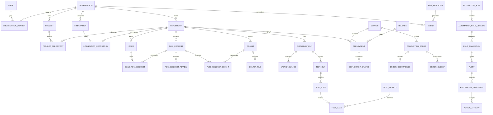

# Entity and tenant model

Status: Alembic `0004_github` adds GitHub authorizations, installation routing, integrations, repositories, sync runs, webhook receipts/inbox, leased jobs, minimal PR/commit projections and normalized events. Tenant tables use forced RLS and composite tenant foreign keys. `0001` through `0003` remain the foundation, identity and social-login history. Phase 4 migration `0006_analytics` adds PR reviews/transitions, explicit commit membership/merge links, file metadata, issues/references and evidence coverage. Phase 5 migration `0007_cicd` adds the six CI/deployment tables below. Phase 6 `0008_test_reports` adds upload credentials, policies and normalized JUnit evidence. Entities outside these implemented scopes remain the phased target.

## Implemented test storage (Phase 6)

| Table             | Grain and boundaries                                                                                                                                                                                     |
| ----------------- | -------------------------------------------------------------------------------------------------------------------------------------------------------------------------------------------------------- |
| `service_tokens`  | Expiring `test_reports:write` credential for one repository; hash, nonsecret prefix, creator and revocation/last-use metadata; raw credential shown once                                                 |
| `test_policies`   | One audited/versioned policy per repository; lookback, minimum samples/transitions, failure-fraction bounds and excluded branches                                                                        |
| `test_reports`    | One workflow-attempt/report-key/shard/content-digest receipt; framework, copied branch/SHA, environment, processing state, timestamps/provenance, warnings, final counts and explicit supersession links |
| `test_suites`     | One parser suite occurrence per report, with parent, path, ordinal and declared versus derived descendant counts                                                                                         |
| `test_identities` | Repository/framework/canonical digest with exact, fallback or ambiguous quality; bounded class/name/file/parameter evidence                                                                              |
| `test_executions` | Every parsed execution, with suite/report/identity, source and retry ordinals, final flag, outcome, nullable duration and bounded 2,048-character failure message                                        |

All six tables force tenant RLS. Composite foreign keys require the same organization/repository; a suite parent belongs to the same report, and an execution's suite belongs to its report. The report's workflow attempt is mandatory and already imported, while its service token is nullable only for the internal demo path. Jobs add a `test_report` kind and report reference. A fenced worker transaction inserts normalized evidence and advances report completion/supersession together.

Receipt uniqueness prevents identical-report replay from duplicating cases. Successful explicit corrections replace current metric eligibility while retaining old evidence. Pending XML is encrypted, cleared after terminal handling and bounded by one-day expiry cleanup. Normalized messages are untrusted tenant-readable text; stdout/stderr/properties are not persisted. Existing source history stays readable after integration disconnection. [Upload contract](junit-setup.md), [ADR 014](adr/014-test-intelligence.md)

## Implemented CI/deployment storage (Phase 5)

| Table                        | Grain and evidence                                                                                                                                                  |
| ---------------------------- | ------------------------------------------------------------------------------------------------------------------------------------------------------------------- |
| `workflow_runs`              | Organization/repository/provider run/attempt; original creation, known queue/start/completion, completion provenance, raw status/conclusion and jobs/links coverage |
| `workflow_jobs`              | Organization/attempt/provider job; timestamps, result, bounded step metadata and unknown-by-default failure category, never logs                                    |
| `workflow_run_pull_requests` | Explicit provider-reported same-repository run/PR association                                                                                                       |
| `deployment_environments`    | Organization/repository/exact environment name; optional audited production classification override                                                                 |
| `deployments`                | Organization/repository/provider deployment; explicit provider environment flags, full SHA and optional resolved commit/workflow identity, status coverage          |
| `deployment_statuses`        | Organization/deployment/provider status; all observed states and source timestamps, never external log/target URLs                                                  |

All six force tenant RLS. Composite foreign keys reject cross-tenant and cross-repository links. Repository CI and deployment coverage/windows are independent. First success is queried from status facts rather than incremented on delivery. Complete job enumeration may establish a labeled completion proxy; original workflow creation never establishes a rerun's queue time. Generated facts retain Phase 4 repository/change IDs and the same persisted anchor.

## Implemented GitHub storage (Phase 3)

`0004_github` adds eleven tables; `0005_github_access` scopes repository uniqueness to an installation and adds the retention index. All eight tenant tables enforce forced RLS. Global control rows are accessed only by session-bound authorization or verified provider routing.

| Table                          | Grain and key                                                                                                                              |
| ------------------------------ | ------------------------------------------------------------------------------------------------------------------------------------------ |
| `github_app_authorizations`    | Global one-use browser/session/user/organization attempt; hashed state, encrypted temporary user token, expiry                             |
| `github_installation_bindings` | Global unique installation ID to organization/integration routing; retained after disconnect                                               |
| `webhook_receipts`             | Global unique delivery UUID, body digest, event, status and resolved routing; no raw payload                                               |
| `integrations`                 | Tenant-owned GitHub App installation and current access status                                                                             |
| `repositories`                 | Unique `(organization_id, integration_id, provider_id)`; selection, source metadata and last successful coverage watermark                 |
| `sync_runs`                    | Catalog/history/incremental run, window, page checkpoint, processed counters and outcome; at most one active run per catalog or repository |
| `webhook_inbox`                | Tenant-owned accepted delivery payload and processing state                                                                                |
| `jobs`                         | Tenant-owned durable sync/inbox job with unique dedup key, availability, finite attempts, lease token and fence                            |
| `pull_requests`                | Current imported snapshot, unique organization/repository/PR number; source timestamp guards older updates                                 |
| `commits`                      | Imported commit, unique organization/repository/full SHA                                                                                   |
| `events`                       | Normalized immutable observation, unique organization/source key; repository and integration composite references                          |

Reinstalling an App creates a new integration and repository identities while retaining the old import history. Repository IDs never silently move across installation boundaries. Phase 4 extends this operational ingestion model with review/lifecycle evidence and timing queries. Project grouping and later analytical serving models remain planned. The `0005` downgrade refuses uniqueness contraction if multiple installation histories exist rather than deleting them.

## Shared conventions and invariants

Phase 4 evidence tables use UUID IDs, forced tenant RLS, natural-key uniqueness, and same-repository composite references. `pull_request_reviews` retains source state, known original state and submitted/approved/dismissed timestamps. `pull_request_transitions` preserves explicit lifecycle events by source key. `pull_request_commits` distinguishes head membership from actual merge SHA; one commit may belong to several PRs. `commit_files` stores names, rename origin, status and counts without patches. `issues` and `issue_pull_requests` retain only explicit same-repository references. Coverage status/error/observation timestamps live beside each source fact; metrics reduce reviews to PR grain before aggregating to avoid fan-out.

The existing job queue gains `kind=enrichment` and a repository/integration composite reference, plus a bounded JSON page/revision checkpoint. `repositories.is_demo` marks generated history; its disconnected integrations have no live installation binding. Synthetic IDs are stable within their designated demo tenant, with a persisted generation anchor for repeatable 90-day history.

- Internal identifiers are UUIDs; provider IDs are separate identifiers (positive bigint GitHub IDs and full commit SHAs in Phase 3). A GitHub numeric ID, SHA, PR number, or URL is never a tenant authorization credential.
- Every organization-owned row has a non-null `organization_id`. This includes junctions, test cases, background jobs, raw events, metric evidence and action attempts. Global identities and narrowly scoped authentication/routing control records are exceptions documented below.
- Tenant tables expose `UNIQUE (organization_id, id)`. Tenant references use composite foreign keys such as `(organization_id, repository_id) REFERENCES repositories(organization_id, id)`. Validate same-repository relationships as well, using additional composite keys where required.
- Use `timestamptz`, store UTC, serialize RFC 3339, and query half-open windows `[from, to)`. Distinguish provider `occurred_at`/`source_updated_at` from Forge `received_at`/`ingested_at`/`updated_at`.
- Use nonnegative integer counters and numeric durations in seconds. Unknown timestamps and counts are null, never fabricated. JSONB holds bounded provider metadata, rule schemas and evidence, not primary relationship keys.
- Preserve imported source URLs, external IDs, normalization version and lineage. State projections can change; immutable review/status/event observations preserve history.
- Credentials are encrypted with a key outside PostgreSQL; API responses expose credential presence/expiry only. Passwords and opaque tokens are hashed.
- Operational records are deleted through an organization-scoped purge workflow. Restrict accidental parent deletion; explicitly order dependent cleanup. Revoking an integration stops collection but preserves existing history until the owner deletes it.

## Core relationship diagram

Optional commit/workflow/release links are described below rather than drawn as mandatory paths. A deployment can exist without a test report. Phase 6 test uploads require an already synchronized exact workflow attempt; accepting standalone or unresolved workflow reports remains a future extension of the target model.

## Identity and SaaS foundation (Phase 2)

| Entity            | Grain and important fields                                                                                | Constraints                                                                                     |
| ----------------- | --------------------------------------------------------------------------------------------------------- | ----------------------------------------------------------------------------------------------- |
| `users`           | Global person: canonical email, name, nullable Argon2id password hash, email_verified boolean, created_at | Unique canonical email; null hash for provider-only accounts; never expose password hash        |
| `organizations`   | Tenant root: name, slug, created_by, is_demo, created_at, deleted_at                                      | Unique slug; its id is the tenant boundary; soft deactivation denies access                     |
| `memberships`     | One organization/user pair: role owner/admin/member/viewer and created_at                                 | Composite organization/id primary key, unique organization/user, locked last-owner invariant    |
| `invitations`     | Organization, email, role, token_hash, inviter membership, expiry, used_at, revoked_at                    | Composite tenant inviter reference; one-use token; current inviter role rechecked on acceptance |
| `auth_sessions`   | Global user session/family: user_id, csrf_hash, created_at, expires_at, revoked_at                        | Access JWT refers to an active session; per-request revocation check                            |
| `refresh_tokens`  | One opaque refresh token hash: session_id, created_at, used_at                                            | Retain spent hashes for replay detection and family revocation                                  |
| `identity_tokens` | One verification/reset token hash: user_id, purpose, expires_at, used_at, created_at                      | Atomic one-use consumption; reset revokes sessions; no raw token persisted                      |
| `rate_limits`     | Hashed operation/IP or operation/account key: window_start, attempts                                      | Atomic PostgreSQL window counter shared by API processes                                        |
| `audit_events`    | Tenant action: actor_id, subject_id, action, created_at                                                   | Composite organization/id primary key; runtime has SELECT/INSERT only                           |

`0003_oauth` adds `external_identities` keyed by `(provider, subject)`, unique on `(user_id, provider)`, with the observed provider email and creation time. `oauth_states` stores hashed state/browser binding, provider, intent, safe local destination, optional user/session binding, expiry and consumption timestamps. PKCE verifiers and Google nonces are derived with purpose-separated HMAC; raw provider tokens are not stored. Both are global authentication tables. User disablement, organization timezone, richer audit payloads and security-event retention remain future extensions.

Global auth records cannot be queried through tenant resource endpoints. Organization creation inserts the root and initial owner atomically through a narrow bootstrap use case. Membership discovery is user-scoped and does not grant access to arbitrary organization data.

## Engineering catalog and GitHub history (Phases 3–4)

| Entity                | Grain and important fields                                                                                                                                                         | Natural key / relationship                                                                                                  |
| --------------------- | ---------------------------------------------------------------------------------------------------------------------------------------------------------------------------------- | --------------------------------------------------------------------------------------------------------------------------- |
| Integration           | One organization/provider connection: provider, external account, GitHub App identity where applicable, encrypted credential reference, status, granted permissions, sync settings | Organization/provider/external account; globally unique GitHub App/installation binding to one Forge organization initially |
| Repository            | One repository within a tenant: provider ID, owner/name, URL, language, default branch, archived, last activity                                                                    | Organization/provider/provider repository ID; names may change                                                              |
| IntegrationRepository | Connected source/repository pair; enabled and source coverage                                                                                                                      | Organization/integration/repository; all same tenant                                                                        |
| Project               | Forge grouping: name, slug, description                                                                                                                                            | Organization/slug                                                                                                           |
| ProjectRepository     | Project/repository membership                                                                                                                                                      | Organization/project/repository                                                                                             |
| Issue                 | GitHub issue identity: repository, provider ID, number, title, state, opened/closed times, source URL                                                                              | Organization/repository/provider issue ID                                                                                   |
| IssuePullRequest      | Explicit closing/reference link and evidence; `closes` distinct from `mentions`                                                                                                    | Organization/issue/PR/link type                                                                                             |
| PullRequest           | Repository, provider ID, number, author, base/head refs and SHAs, state/draft, opened/first-review/first-approval/merged/closed times, merge SHA, change counts                    | Organization/repository/provider PR ID; also unique repository/number within tenant                                         |
| PullRequestReview     | Review event: PR, provider review ID, actor, submitted time, state, dismissed time                                                                                                 | Organization/PR/provider review ID; first approval is historical, not current approval permission                           |
| PullRequestTransition | State/draft/reopen transition with source time, provider event ID and evidence                                                                                                     | Organization/PR/provider event ID or canonical event key                                                                    |
| Commit                | Repository, full SHA, authored/committed times, author metadata, message summary                                                                                                   | Organization/repository/SHA; no abbreviated SHA keys                                                                        |
| PullRequestCommit     | Many-to-many PR/commit membership and source evidence                                                                                                                              | Organization/PR/commit; both from same repository                                                                           |
| CommitFile            | Commit/path change: status, additions, deletions, old path for rename                                                                                                              | Organization/commit/path; store metadata rather than patches by default                                                     |

Merge/squash/rebase differences are retained: merge SHA can differ from head SHA and PR commit SHAs. A commit can belong to multiple PRs. Never infer a single PR from a SHA without keeping candidate multiplicity.

## CI and test entities (Phases 5–6)

| Entity                 | Grain and important fields                                                                                                                                                      | Natural key / relationship                                                                                               |
| ---------------------- | ------------------------------------------------------------------------------------------------------------------------------------------------------------------------------- | ------------------------------------------------------------------------------------------------------------------------ |
| WorkflowRun            | **One workflow attempt**: repository, provider workflow/run IDs, attempt number, name/path, event, branch, head SHA, status/conclusion, queued/started/completed times          | Organization/repository/provider run ID/attempt; nullable resolved commit ID                                             |
| WorkflowRunPullRequest | Provider-reported workflow/PR association                                                                                                                                       | Organization/workflow run/PR; same repository                                                                            |
| WorkflowJob            | One job attempt: run, provider job ID, name, matrix dimensions, runner labels, status, timestamps, failure category                                                             | Organization/workflow run/provider job ID                                                                                |
| TestRun                | One report artifact/shard for an imported workflow attempt: repository, workflow run, commit SHA, framework, environment, digest, shard/report key, received time, completeness | Unique organization/repository/workflow attempt/report key/shard/digest; standalone uploads are not supported in Phase 6 |
| TestSuite              | One suite occurrence in a report: run, hierarchical suite path, ordinal, declared counters                                                                                      | Organization/test run/suite path/ordinal; nested suites flattened without double-counting descendants                    |
| TestIdentity           | Stable logical test: repository, framework, file/module, class, name, parameter signature                                                                                       | Organization/repository/canonical identity digest; fallback identity quality recorded                                    |
| TestCase               | **One test execution**: suite, identity, ordinal, retry ordinal, status `passed/failed/error/skipped`, duration, bounded failure message                                        | Organization/suite/ordinal; repeated/parameterized tests remain distinct                                                 |
| TestPolicy             | Repository flakiness settings: lookback, minimum executions, failure-rate bounds, minimum flips, excluded branches                                                              | One active version per repository; policy version accompanies results                                                    |

Optional workflow-to-commit links can remain null until their explicit source references resolve. Phase 6 report-to-workflow links are mandatory and same-repository; an upload without that imported parent is rejected. Tenant-safe natural keys handle identical report replays. Declared XML counters are checked against final leaf executions; a mismatch is recorded as quality evidence.

## Deployment and production entities (Phases 5 and 7)

| Entity                    | Grain and important fields                                                                                                                                                    | Natural key / relationship                                                                                                  |
| ------------------------- | ----------------------------------------------------------------------------------------------------------------------------------------------------------------------------- | --------------------------------------------------------------------------------------------------------------------------- |
| Service                   | Organization-owned deployed service: name, slug, optional project                                                                                                             | Organization/slug                                                                                                           |
| ServiceRepository         | Service/repository mapping, optional component path                                                                                                                           | Organization/service/repository/component                                                                                   |
| IntegrationServiceMapping | External project/service mapping: integration, external project ID, Forge service, source environment mapping                                                                 | Organization/integration/external project ID; explicit service/repository mappings resolve source scope                     |
| Environment               | Named environment with production flag                                                                                                                                        | Organization/name; explicit production mapping                                                                              |
| Release                   | Provider release version, integration, service, source URL                                                                                                                    | Organization/integration/service/version                                                                                    |
| ReleaseCommit             | Explicit release/commit relationship and provider evidence                                                                                                                    | Organization/release/commit                                                                                                 |
| Deployment                | Provider deployment: repository, optional service, environment, commit SHA, optional resolved commit/workflow/release, created/started/finished times, projected state        | Organization/integration/provider deployment ID; first successful finish drives deployment metrics                          |
| DeploymentStatus          | Immutable provider status transition: deployment, state, source time, provider status ID                                                                                      | Organization/deployment/provider status ID                                                                                  |
| DeploymentFlag            | Advisory risk/rollback-candidate flag: deployment, evaluation, alert, reason, state, created/resolved times                                                                   | Organization/deployment/alert/flag type; advisory only, no deployment mutation                                              |
| ProductionError           | **One source error group**: integration, external project/group ID, service, type/title/fingerprint, status, first/last seen                                                  | Organization/integration/external project/group ID; group totals are snapshots, not window counts                           |
| ErrorOccurrence           | Optional retained event sample: error group, provider event ID, environment, release, occurred time, pseudonymous user key                                                    | Organization/integration/provider event ID; sampling/coverage marked                                                        |
| ErrorBucket               | **One provider aggregate bucket per group, environment and release scope**: start/end, count, optional distinct-user count, source query scope, completeness, source revision | Organization/group/environment/release scope/bucket start/grain; replace revised counts, never add overlapping poll results |
| ErrorUserAggregate        | Distinct affected-user result for an exact provider query window/scope, fetched time                                                                                          | Organization/query-scope hash/from/to; nonadditive across groups or windows                                                 |
| CorrelationLink           | Directed link: source/target kind and ID, relation type, `explicit/temporal`, evidence references, method/version, candidate rank, observed time                              | Organization/source/target/type/method version; typed endpoints validated in same tenant                                    |

Unknown environment/release values use explicit dimension members for stable bucket keys; they are not silently treated as production. Avoid mixing all-release totals with per-release buckets. Choose one disjoint aggregation scope per metric query. If the provider cannot supply a requested dimension, the metric is unavailable for that scope.

`CorrelationLink` is a flexible evidence index, not a replacement for typed foreign keys. A polymorphic endpoint has no ordinary FK: the service must validate existence and tenant membership transactionally; integrity audits detect dangling links. Known lifecycle relationships retain typed FK/junction representations, and reads join tenant-scoped endpoints. Temporal links never confer authorization or authorize an action target.

## Ingestion, reliability and automation (Phases 3–9)

| Entity                | Grain and important fields                                                                                                                                              | Constraints                                                                                                               |
| --------------------- | ----------------------------------------------------------------------------------------------------------------------------------------------------------------------- | ------------------------------------------------------------------------------------------------------------------------- |
| AppWebhookEndpoint    | Global provider-app control record: opaque route binding, app identity, signing-secret reference, enabled state                                                         | Not organization-owned; contains no engineering data; verified installation maps to one tenant-owned Integration          |
| RawIngestion          | One accepted webhook, fetched source item/page or report: integration, source delivery key, content digest, encrypted bounded payload, received time, processing status | Unique organization/integration/source delivery key; changed payload under same delivery key is a conflict                |
| Event                 | One normalized occurrence: event type, schema version, entity key, occurred/received times, integration/repository, raw ID, payload, correlation/causation IDs          | Unique organization/integration/canonical occurrence key/schema version; links raw evidence to normalized entity versions |
| EventEntity           | Event/entity lineage records                                                                                                                                            | Organization/event/entity kind/entity ID; checked like correlation endpoints                                              |
| BackgroundJob         | Durable task: type, scoped resource, dedup key, payload version, status, attempts, available time, lease owner/expiry, lease generation, heartbeat, last safe error     | Unique organization/job type/dedup key; retries reuse job identity                                                        |
| SyncRun               | One requested backfill/reconciliation: source, repository, status, counts, requested coverage, stage, errors                                                            | Organization/integration/request key; partial success explicit                                                            |
| SyncCursor            | Source/resource-stream checkpoint and committed coverage                                                                                                                | Organization/integration/resource/stream; advance only with committed ingestion                                           |
| DataQualityIssue      | Invalid/missing field or relationship: source record, severity, rule/version, reason, resolution                                                                        | Tenant-owned; no unbounded raw payload in message                                                                         |
| AutomationRule        | Rule identity: name, repository/service/environment scope, enabled flag, active version                                                                                 | Organization/id; owner/admin controls enablement                                                                          |
| AutomationRuleVersion | Immutable trigger config, baseline config, action config, cooldown, created by                                                                                          | Organization/rule/version; typed JSON schemas, no arbitrary code/SQL                                                      |
| RuleEvaluation        | One rule version/scope/window/revision evaluation: observed value, baseline inputs, freshness, quality, outcome, evidence refs                                          | Unique organization/rule version/scope/window/revision; stores metric definition version                                  |
| Alert                 | Incident: dedup key, severity, open/acknowledged/resolved state, initial evaluation, last evaluation/time, assignee                                                     | One active incident per rule/scope; repeated evidence updates same incident                                               |
| AutomationExecution   | One requested action per incident/action configuration: state, stable idempotency key, target config snapshot, result summary                                           | Unique organization/incident/action key; durable outbox record                                                            |
| ActionAttempt         | One outbound delivery attempt: execution, number, timestamps, response status, redacted response digest, error                                                          | Unique organization/execution/attempt number                                                                              |
| WebhookDestination    | Admin-configured HTTPS action receiver, encrypted signing secret, allowlisted host/path, status                                                                         | Tenant-owned; referenced by ID in rules, never arbitrary URL in an evaluation                                             |
| ServiceToken          | Repository-scoped CI upload credential hash, scopes, expiry, last use, revoked time                                                                                     | Tenant-owned; cannot manage members, rules, or integrations                                                               |
| IdempotencyRequest    | Tenant/actor/operation/key, request digest, safe response reference and expiry                                                                                          | Unique organization/actor/operation/key; 24-hour response cache, independent of long-lived domain dedup                   |

## Index, migration and retention strategy

Lead common indexes with `organization_id`: repositories by activity, PRs by repository/merged time and state, workflow attempts by repository/completed time, test executions by identity/time through run, deployments by environment/success time, errors by service/environment/bucket start, alerts by status/updated time. Add indexes on FK lookup columns. Job claiming also needs a narrow global readiness index on status/available time; access uses the restricted queue-dispatch mechanism.

Do not partition immediately. Measure raw/event/error growth and introduce partitioning with explicit migration and retention ownership when useful. Store high-volume error buckets first and only bounded event samples. Initial proposed retention: 30 days encrypted raw payloads and error samples, 180 days normalized engineering history/error buckets, 365 days audit/action evidence. Keep compact delivery dedup tombstones after raw deletion for the integration's lifetime, subject to tenant deletion; canonical entity uniqueness is a second replay barrier. Expose coverage so older queries cannot imply completeness.

Alembic owns operational tables, constraints, indexes and RLS policies. Phase 10 dbt owns derived schemas only. Use forward-compatible expand/backfill/contract migrations; validate backups and restoration before destructive schema changes. No `create_all()` production bootstrap or manual production DDL.
