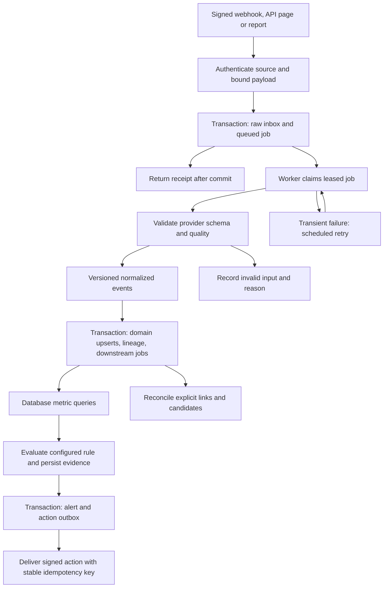

# Ingestion, correlation and automation pipelines

Status: Phase 3 implements the PostgreSQL inbox, fenced job leases, page checkpoints and PR/commit normalization. The worker runs separately from the API. Correlations, action outbox and automation remain Phases 8 and 9; scheduled orchestration remains Phase 10.

## Implemented Phase 3 behavior

The `worker` Compose service runs `python -m forge.workers.github` against the restricted runtime role. One fenced 60-second lease processes one provider page (100 records), then commits its projections and checkpoint together. Jobs survive process restarts. The process heartbeat reports recent healthy iterations; it is distinct from a job lease. The combined load/fetch/persist operation has a 50-second deadline; HTTP calls also have bounded timeouts. No job lease renewal is implemented.

Initial history covers 90 days of updated PRs and default-branch commits. Incremental sync overlaps the last successful watermark by ten minutes. A push also queues reconciliation, including when its payload may be truncated. Requests coalesce into active runs and preserve a follow-up request made during a run. Failed/partial runs resume their saved checkpoint. Each stage has a 100-page capacity bound; each page has eight attempts. Rate-limit Retry-After is honored up to one day; ordinary retries use exponential backoff plus jitter. Capacity and permanent failures stay visible instead of silently reporting completeness.

The worker rechecks active tenant/source/selection and the integration access revision before committing provider results. Removal, suspension and disconnect cancel affected work and invalidate stale leases. Installation lifecycle jobs fetch fresh provider state before reactivating access. PR deliveries fetch an authoritative current snapshot; source timestamp guards reject older projections. Delivery receipts deduplicate exact replays and reject delivery IDs reused with different body digests/events.

Each claimed tenant job opportunistically clears at most 100 successfully processed raw webhook payloads older than seven days. Receipt/dedup metadata and normalized rows remain. Idle tenants wait until their next job for cleanup; failed and queued payloads are retained for diagnosis. This is not a scheduled retention or purge system.

There is no automated polling, missed-delivery recovery, webhook replay UI, per-tenant fairness scheduler, or analytics/action processing in this phase. The remaining diagrams and contracts describe the later target pipeline.

## Durable processing instead of request-bound jobs

Use a PostgreSQL inbox and job queue, consumed by a separate Python process built from the FastAPI backend codebase. FastAPI handles validation and durable acceptance; the worker invokes the same application services. In-process `BackgroundTasks` is not the durable execution mechanism. FastAPI's documentation distinguishes small in-process tasks from heavier background workloads; Forge's database queue is a design decision to obtain crash recovery without adding a broker. [FastAPI background tasks](https://fastapi.tiangolo.com/tutorial/background-tasks/)

Invalid authentication never reaches the inbox. Valid but semantically invalid data is quarantined with a visible quality issue. An unavailable database produces retryable failure, not a success acknowledgement.

## Normalized event envelope

| Field                                             | Meaning                                                                            |
| ------------------------------------------------- | ---------------------------------------------------------------------------------- |
| `id`, `organization_id`, `integration_id`         | Internal identity and server-resolved tenant/source                                |
| `event_type`, `schema_version`                    | Namespaced type such as `github.pull_request.merged`, explicit payload version     |
| `source_event_key`, `entity_key`                  | Provider occurrence key and stable entity natural key; distinct from mutable state |
| `repository_id`                                   | Resolved tenant-owned repository, nullable for service-level events                |
| `occurred_at`, `received_at`, `source_updated_at` | Source occurrence, Forge receipt and optional source revision time                 |
| `raw_ingestion_id`, `normalizer_version`          | Replayable provenance                                                              |
| `correlation_id`, `causation_id`                  | Trace context and initiating Forge event, not proof of business causality          |
| `payload`, `quality_status`                       | Bounded typed normalized data and quality outcome                                  |

For webhook occurrences, derive the event key from delivery ID and item/subevent position. For historical records, use provider entity/revision identifiers or a canonical source-content digest. Entity upsert natural keys provide semantic deduplication across webhook and polling events, which may legitimately be different observations of the same object.

Schema changes are additive within a version. Breaking semantics create a new version and migration/replay plan. A normalizer-version replay writes a new projection generation or reconciles by stable entity key; it must not duplicate counts or automatically re-fire historical actions.

## Job protocol and failure handling

1. Enqueue in the same database transaction as the input or state change requiring work. Enforce a unique dedup key per tenant/job type.
2. Claim due work with `FOR UPDATE SKIP LOCKED` in a short transaction. Store lease owner, expiry and monotonically increasing generation. Commit before external calls.
3. Heartbeat long tasks; require the current lease generation when committing task results. Expired workers cannot mark a reclaimed task complete.
4. Persist normalized changes, event lineage, downstream job/outbox records and task completion atomically. For large syncs, page-sized child jobs/checkpoints are the atomic unit.
5. Retry transient timeouts, 429 and eligible 5xx with exponential backoff and jitter; honor provider retry hints. Initial default is eight attempts, capped at 15 minutes between attempts, configurable by task kind.
6. Invalid schema/permissions and exhausted retries enter visible terminal/quarantined states. Admin-triggered replay preserves original identity and previous attempts.

Worker crashes before commit repeat safely; crashes after commit find the unique completed input. Delivery remains **at least once**. Lease fencing protects database results, not a remote service already called by an expired worker. Remote action receivers must deduplicate stable idempotency keys.

Scheduling initially uses a worker loop and durable `available_at` jobs with unique schedule-slot keys. Multiple schedulers can propose the same slot without duplicating work. Bound concurrency by integration and tenant to avoid one backfill starving live ingestion. Prioritize webhook normalization over deep history without skipping durable work.

For global claiming, use a narrow, audited database function/role that can claim a task and return only its tenant/job identity. It cannot read arbitrary tenant payloads. The worker then opens a tenant-scoped transaction as a non-bypass role. App endpoint lookup and signed installation-to-tenant routing follow the same restricted-control pattern. Do not grant the general API or worker `BYPASSRLS` merely to enumerate tenants.

## Incremental processing and quality

Checkpoint only committed pages; retain a lookback overlap and deduplicate repeated records. Jobs carry source watermarks and requested intervals. Late or out-of-order records update affected historical windows, increment metric revisions and re-evaluate candidate links. Normal ingestion never executes arbitrary SQL supplied by a provider or user.

Quality gates check tenant/source mapping, required IDs, allowed status values, nonnegative durations/counters, timestamp ordering, foreign-key resolution and report counter consistency. Invalid required identities block persistence; unresolved optional links preserve usable data with reduced coverage. Keep rejected record count and reasons; do not silently discard them from the denominator.

Manual replay defaults to `effects_disabled=true`: rebuild projections and analytics without delivering past alerts/actions. Any operator-requested live re-evaluation is an audited explicit mode and retains action dedup keys. Backfill is also excluded from live action execution unless the rule's configured current window is valid and fresh.

## Lifecycle correlation (Phase 8)

| Relationship                  | Strong evidence                                                            | Candidate evidence                                                          |
| ----------------------------- | -------------------------------------------------------------------------- | --------------------------------------------------------------------------- |
| Issue → PR                    | Provider closing/reference link, classified by relation type               | Issue number mentioned without verified source context                      |
| PR → Commit                   | Provider commit membership, full merge SHA                                 | Branch/time overlap only                                                    |
| Commit → Workflow             | Exact repository and head SHA, provider run metadata                       | Similar branch/time alone                                                   |
| Workflow → Tests              | Uploaded verified run/attempt/job identity                                 | Same SHA and nearby test time, labeled ambiguous                            |
| Workflow/Commit → Deployment  | Provider deployment SHA or explicit workflow manifest                      | Nearby successful workflow without explicit ID                              |
| Deployment → Production error | Release mapping with repository commit identity and deployment environment | Error first-seen/spike after deployment within matching service/environment |

An explicit deployment/release relationship still does not prove defect causality. Temporal correlation defaults to a configurable 60-minute post-deployment window, restricted to the same tenant/service/environment and mapped repositories. Store competing deployments, time distance, baseline and observed counts, input IDs, method/version and an ordinal strength label. Avoid numerical probability unless calibrated. Ambiguous/unmapped service identity produces no deployment attribution.

Correlation UI and API return explicit links separately from candidates. Candidate edges cannot determine an external action target; action scope is configured and authorized independently.

## Baseline anomaly evaluation (Phase 9)

Initial signal: production error **occurrences per minute**, for a configured repository/service/environment. Default observed window is 15 minutes, evaluated after a configurable ingestion grace period (initially 5 minutes). Baseline uses complete nonoverlapping 15-minute buckets in the preceding seven days, excluding the observed window and any overlap. Store the exact windows, sample count, mean, population standard deviation, source coverage and formula version.

Default quality gates: at least 96 baseline buckets and at least 90% known coverage of the requested baseline, a complete observed window, current source watermark, and at least 10 observed occurrences. No data is not a zero bucket; a zero bucket exists only when the source query successfully covered that interval.

Rules support an explicit ratio trigger such as `observed_rate > 2 * baseline_mean`. A separate statistical condition can be enabled, such as `observed_rate > baseline_mean + 3 * baseline_stddev`; combining them is stored as an explicit AND/OR predicate, not a hidden requirement. If mean is zero, the ratio is undefined: use a separately configured absolute trigger or report insufficient baseline. If deviation is zero, report an undefined z-score and use any configured ratio/absolute condition without division by zero. Initial thresholds are configurable product defaults, not statistical guarantees.

The initial model does not correct for seasonality, traffic shifts, or multiple comparisons. Display that limitation in anomaly evidence. It detects unusual activity, not causation. Version changes cannot silently reinterpret existing evaluations.

## Alert and automation transaction

Example configured behavior: when `production_error_occurrences_per_minute` exceeds twice its baseline and coverage requirements pass, create a HIGH alert, flag the associated deployment as a **rollback candidate** where evidence supports it, and request a configured pipeline halt webhook. A flag is an advisory Forge record; it is not a rollback command.

Persist the RuleEvaluation, incident creation/update and AutomationExecution in one transaction. Incident dedup key is rule plus scope and active incident generation. A rule revision alone does not create another incident while one is open. Default cooldown is 60 minutes; repeated positive evaluations update evidence, with reminder actions only if explicitly configured. Recovery requires three consecutive complete below-threshold windows before auto-resolution; no-data does not count as recovery. Manual acknowledgement does not stop configured actions; disabling the rule cancels unsent work.

Rule configuration is a typed declarative schema: metric, scope, window, baseline, comparison, threshold, quality gates, severity, cooldown, and actions. Disallow arbitrary code, shell commands, SQL or URL interpolation. Rules begin disabled; the administrator can preview historical evaluations before enablement. Alert creation and outbound delivery each have separately inspectable states.

## Outbound webhook delivery

Destinations are preconfigured, tenant-owned HTTPS endpoints. Resolve/validate DNS at delivery, reject private/link-local/loopback/metadata addresses in production, block redirects, and apply network-level egress restrictions to close DNS rebinding/TOCTOU gaps. Initial timeout is 10 seconds with bounded response bodies. Sign canonical request bytes using a per-destination HMAC secret and include delivery ID, timestamp, schema version and stable `Idempotency-Key`.

Payload contains tenant-safe repository/deployment references, action kind `halt_pipeline`, alert/evaluation links and measured evidence; no provider tokens. The receiver validates signatures/timestamp and durably deduplicates before acting. A 2xx means accepted delivery only unless a separately defined receiver protocol provides a verifiable outcome. Timeout after sending is `unknown` until retry/reconciliation, not proof of failure or success. Record each attempt, use bounded retries, and show exhaustion prominently. Recheck rule/destination enabled status immediately before dispatch; an already in-flight call cannot be recalled.

Automatic rollback execution and native GitHub deployment cancellation are not initial capabilities. They require additional scoped adapter permissions, explicit target semantics and a later decision. Forge's Phase 9 action is the authorized signed webhook request plus traceable evidence.

## Evolution to dbt, Airflow and streaming

Phase 10 moves scheduled batch/reconciliation ownership to Airflow and runs dbt quality/build jobs. Disable duplicate worker schedules when moving each job type. Airflow calls the same idempotent ingestion services and respects tenant scoping; webhook and outbox workers remain active. Airflow's architecture provides scheduler/executor components for this orchestration role. [Airflow architecture](https://airflow.apache.org/docs/apache-airflow/stable/core-concepts/overview.html)

Phase 11 introduces a transactional event outbox relay to Kafka, keyed by tenant and aggregate identity. Acknowledge source writes only after the PostgreSQL transaction; never dual-write PostgreSQL and Kafka without an outbox. Consumers persist offsets/dedup state and tolerate replay/schema evolution. Partition ordering is per aggregate, not a global ordering claim.

Phase 12 projects immutable facts/revisions into ClickHouse with deletion propagation and reconciliation counts. Keep the PostgreSQL query implementation as an oracle during migration. Choose one serving source per metric/version with a visible watermark; do not blend unmatched freshness or silently fall back to different semantics.
